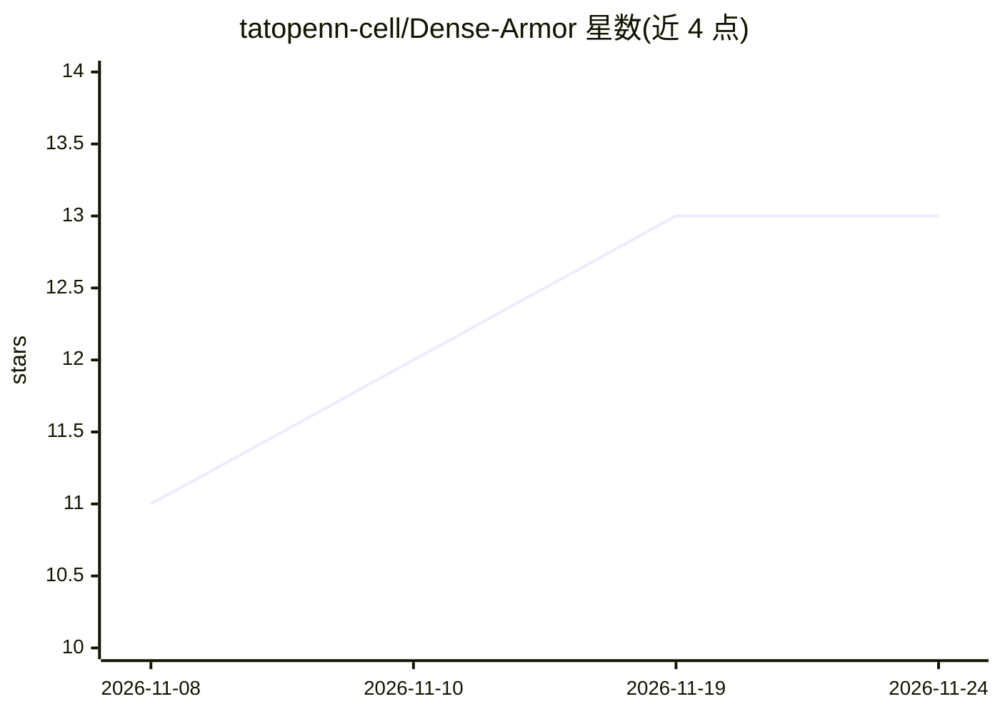

# tatopenn-cell/Dense-Armor

⭐ 13 · Python · AGPL-3.0 · 推送 2026-11-20 · [GitHub](https://github.com/tatopenn-cell/Dense-Armor) · [官网](https://tatopenn-cell.github.io/Dense-Armor/) · 个人维护

**给流式数据开发者的在线学习/信号防护原语库**

Python 工具库，提供三层原语：在线学习（逐样本 learn_one/score_one 契约）、深度学习组件（层、注意力、卷积/循环块、EWC/GEM/A-GEM 持续学习）与批量机器学习类。覆盖异常检测、漂移检测、时间序列、金融预交易风控与哈希链决策日志、机器人指令限界等。所有估计器经 JAX 后端运行，面向逐样本到达、需边运行边学习或保持稳定的数据管道开发者。需 Python 3.10+。

## 筛选速览

| 维度 | 判定 | 备注 |
|---|---|---|
| AI 角色 | `ai-native` | 本体是模型或模型工具 |
| 许可风险 | `viral` | AGPL-3.0 |
| 部署形态 | `library` | 以包/库形式分发 |
| 模型依赖 | — | README 未给出锁定关系 |
| 硬件要求 | `cpu-ok` | |
| 安装摩擦 | `low` | 无编译、无系统依赖或容器化 |
| 成熟度 | — | 结构信号不足 |

## 能力要点

- 统一的 learn_one/predict_one/score_one 逐样本接口，CPU 或 GPU 经 JAX 运行
- 持续学习（EWC、GEM、A-GEM）与流式训练的深度学习组件
- 金融预交易风控与可验证的哈希链决策日志
- 机器人控制限界（速率限制、CBF）与 NaN/尖峰运行时屏蔽

## 适用场景

- 给无人机/机械臂传感器流做在线异常与漂移检测
- 交易流水线做预交易风控并留下可审计的决策日志
- 神经网络训练循环中做持续学习而不遗忘旧任务
- 监控已部署 ML 模型的输入漂移与数值异常

## 场景标签

`金融量化` · 领域:学习与行业

## 证据(README 行号)

> L17:  Composable, low-level primitives for real-time signal processing, physical sensor protection, and continuous learn
> L60: Dense-Armor is a low-level learning toolkit on three levels: online learning, deep learning and machine learning. E

## 星数曲线

2026-11-08 11 → 2026-11-24 13（+2）

---
*卡片 v1 · prompt 1.4 · 生成 2026-11-18 · 置信度 high · 依据 README sha `6f4bef771d58` · [字段定义](../../DATASET.md)*
