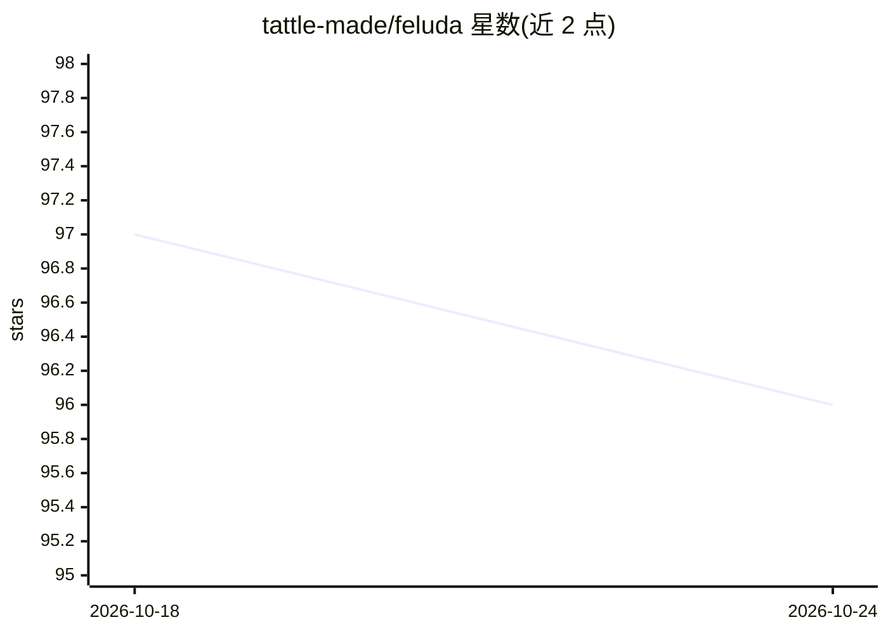

# tattle-made/feluda

⭐ 96 · Python · GPL-3.0 · 推送 2026-10-19 · [GitHub](https://github.com/tattle-made/feluda) · [官网](https://tattle.co.in/products/feluda/) · 组织维护

**分析多语言多模态内容的可配置引擎（文本/图像/音视频）**

面向社交媒体数据（图像、文本、视频）分析的可配置 Python 引擎：以算子（operator）为插件单元，用户在 yml 配置中指定所需算子，引擎据此加载并执行向量嵌入（ResNet、Sentence Transformers）、pHash 哈希检索、图文文本抽取与实体抽取等分析。算子可自行开发、可替换，同一操作可选用 ML 模型或哈希等轻量实现。以 pip 安装主包加各算子包的形式提供，面向构建搜索、聚类与分析服务的开发者。

## 筛选速览

| 维度 | 判定 | 备注 |
|---|---|---|
| AI 角色 | `ai-native` | 本体是模型或模型工具 |
| 许可风险 | `viral` | GPL-3.0 |
| 部署形态 | `library` | 以包/库形式分发 |
| 模型依赖 | — | README 未给出锁定关系 |
| 硬件要求 | — | 无带数字的原话,不猜 |
| 安装摩擦 | `low` | 无编译、无系统依赖或容器化 |
| 成熟度 | — | 结构信号不足 |

## 能力要点

- 算子插件架构，yml 配置指定分析模块，可自研与替换
- 支持 ResNet/Sentence Transformers 向量嵌入与 pHash 哈希检索
- 图像文本抽取与图文实体抽取并索引入引擎
- 同一操作可在重模型与轻量实现（如哈希替代 ML 模型）间选择

## 适用场景

- 对社交媒体图文视频数据构建搜索与聚类服务
- 多语言（含印度语言）多模态数据的批量分析
- 按预算在 ML 模型与哈希方案间切换做图像聚合

## 场景标签

 · 领域:多模态内容分析/NLP/CV

## 证据(README 行号)

> L4: A configurable engine for analysing multi-lingual and multi-modal content.
> L14: When we built Feluda, we were focusing on the unique challenges of social media data in India. We needed to process

## 星数曲线

2026-10-18 97 → 2026-10-24 96（-1）

---
*卡片 v1 · prompt 1.4 · 生成 2026-10-23 · 置信度 high · 依据 README sha `4507e673ad74` · [字段定义](../../DATASET.md)*
