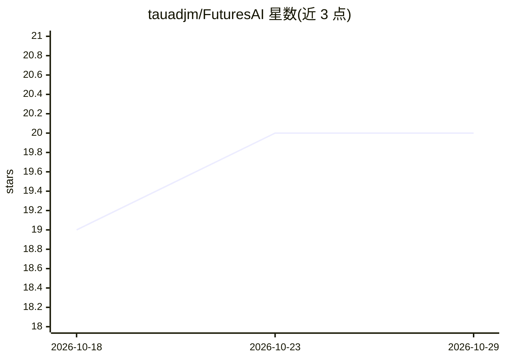

# tauadjm/FuturesAI

⭐ 20 · Python · MIT · 推送 2026-04-21 · [GitHub](https://github.com/tauadjm/FuturesAI) · 个人维护 · 中文 README

**LLM 驱动的中国商品期货自动交易与回测系统**

基于 Python/FastAPI 的量化交易系统，用 LLM 替代规则引擎读取 K 线特征并输出结构化交易信号（开仓/持仓/平仓/反手），经天勤量化（TqSdk）执行下单，配套追踪止损守卫与尾盘强制平仓。回测系统逐根 K 线重建上下文并调用真实 LLM，与实盘共享代码路径；另有 analyze_trades.py 离线交易统计脚本。支持 Claude/GPT-4o/DeepSeek/Gemini/Grok/Qwen3/OpenRouter 等模型。默认内置价格行为学策略以编译 .pyd 发布，源码不公开；需要天勤账号与 API Key。作者声明代码由 AI 生成，仅供建议研究用途勿直接实盘。

## 筛选速览

| 维度 | 判定 | 备注 |
|---|---|---|
| AI 角色 | `ai-native` | 本体是模型或模型工具 |
| 许可风险 | `permissive` | MIT |
| 部署形态 | `library` | 以包/库形式分发 |
| 模型依赖 | locked-api |  |
| 硬件要求 | — | 无带数字的原话,不猜 |
| 安装摩擦 | `low` | 无编译、无系统依赖或容器化 |
| 成熟度 | — | 结构信号不足 |

## 能力要点

- LLM 读取预计算特征块输出 JSON 交易信号，多合约并发分析
- 回测逐根重建上下文调用真实 LLM，与实盘代码路径共享
- 追踪止损守卫（0.6R/1R/2R 三档）与尾盘强制平仓
- 策略插件化，继承 BaseStrategy 可替换策略

## 适用场景

- 在国内商品期货市场运行 LLM 决策的自动交易
- 用真实 LLM 调用对 AI 策略做历史回测验证
- 对实盘/模拟交易记录做多维度统计分析

## 场景标签

`金融量化` · 领域:学习与行业

## 证据(README 行号)

> L7: 本项目是一套**可替换策略架构**的量化交易系统，核心创新点在于用 LLM 替代传统规则引擎，让 AI 直接阅读 K 线特征并输出结构化交易信号。默认内置基于价格行为学的策略实现。
> L9: 系统支持同时分析多个商品期货合约，AI 每根 K 线收盘后自动触发分析，输出开仓/持仓/平仓/反手决策，并通过追踪止损守卫管理风险。配套回测系统支持逐根 K 线重建市场上下文、调用真实 LLM 决策并模拟追踪止损出场，实现 AI 策

## 星数曲线

2026-10-18 19 → 2026-10-29 20（+1）

---
*卡片 v1 · prompt 1.4 · 生成 2026-10-28 · 置信度 mid · 依据 README sha `99bf3a92edb6` · [字段定义](../../DATASET.md)*
