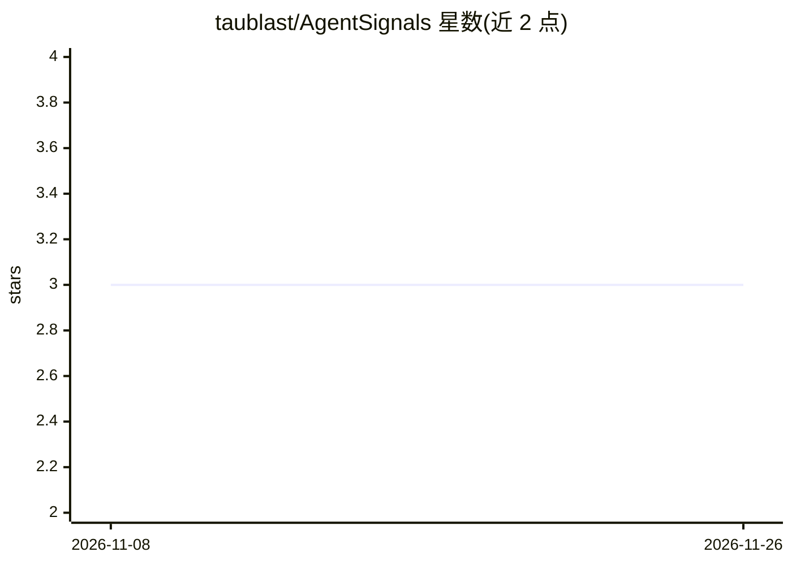

# taublast/AgentSignals

⭐ 3 · Rust · MIT · 推送 2026-11-25 · [GitHub](https://github.com/taublast/AgentSignals) · 个人维护

**在单窗口集中管理并监视 Claude Code 会话状态的桌面应用**

面向在多个终端中同时运行 Claude Code agent 的开发者，把所有会话汇总到一个小窗口中，按颜色区分等待输入、工作中、提出问题、刚完成与空闲等状态，并可通过语音播报、声音、系统通知或任务栏闪烁提示会话完成。应用直接读取 Claude Code 自身的会话注册表与对话文件，无需在 Claude Code 中做任何配置，支持一键重开上次会话、跳转终端或 VS Code 窗口。提供 Windows 与 macOS 预编译下载，Rust 编写。

## 筛选速览

| 维度 | 判定 | 备注 |
|---|---|---|
| AI 角色 | `ai-ecosystem` | LLM/agent 周边工具 |
| 许可风险 | `permissive` | MIT |
| 部署形态 | `desktop` | 安装包/桌面程序 |
| 模型依赖 | — | README 未给出锁定关系 |
| 硬件要求 | — | 无带数字的原话,不猜 |
| 安装摩擦 | `medium` | 含编译或系统依赖之一 |
| 成熟度 | — | 结构信号不足 |

## 能力要点

- 通过颜色与图标显示每个 Claude Code 会话的实时状态
- 完成时支持语音播报、声音、通知与任务栏/Dock 闪烁四种信号
- 读取 Claude Code 会话注册表与对话文件，无需额外配置
- 一键用 claude --resume 重开上次会话，支持 8 种界面语言

## 适用场景

- 同时开多个终端跑 Claude Code agent 时统一查看谁在等待回复
- 会话完成或需要授权时收到桌面通知提醒
- 重启后一键恢复之前打开的所有 agent 会话

## 场景标签

 · 领域:开发工具/AI agent 管理

## 证据(README 行号)

> L3: **Agent Signals for Claude Code**: a small app for Windows and macOS that shows all your Claude
> L161: - **Sessions** come from Claude Code's own registry, `~/.claude/sessions/<pid>.json` (name, `busy`

## 星数曲线

2026-11-08 3 → 2026-11-26 3（+0）

---
*卡片 v1 · prompt 1.4 · 生成 2026-11-21 · 置信度 high · 依据 README sha `229c5925391d` · [字段定义](../../DATASET.md)*
