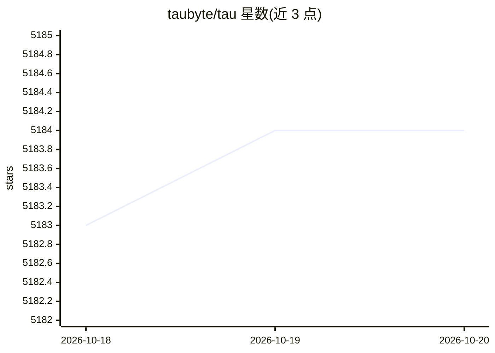

# taubyte/tau

⭐ 5,184 · Go · BSD-3-Clause · 推送 2026-08-16 · [GitHub](https://github.com/taubyte/tau) · [官网](https://taubyte.com) · 组织维护

**面向人类与 AI agent 的全栈云工作区（函数/托管/存储）**

Taubyte 是一个自托管的分布式云计算平台，提供 Serverless 函数、Web 托管、KV 数据库、对象存储与 Pub/Sub 消息服务。定位为『人类与 AI agent 共用的全栈工作区』，工作流为 Prompt → 本地 → 生产：通过 Dream 在本地启动环境，支持手动或 Spore Drive 自动化部署到自有服务器/VM。面向希望在自己基础设施上构建和运行分布式应用的开发者，采用 BSD-3-Clause 许可。README 未给出具体安装命令，部署细节指向文档站。

## 筛选速览

| 维度 | 判定 | 备注 |
|---|---|---|
| AI 角色 | `ai-enhanced` | 去掉 AI 部分产品仍成立 |
| 许可风险 | `permissive` | BSD-3-Clause |
| 部署形态 | `None` |  |
| 模型依赖 | — | README 未给出锁定关系 |
| 硬件要求 | — | 无带数字的原话,不猜 |
| 安装摩擦 | `low` | 无编译、无系统依赖或容器化 |
| 成熟度 | — | 结构信号不足 |

## 能力要点

- 提供函数、Web 托管、KV 数据库、对象存储、Pub/Sub 消息
- Prompt → Local → Prod 工作流，支持 AI agent 参与构建与部署
- 可通过 Dream 本地启动，或手动/Spore Drive 部署到自有服务器与 VM

## 适用场景

- 在自己服务器上搭建 serverless 函数与网站托管环境
- 本地先用 Dream 起环境调试，再部署到生产
- 让 AI agent 通过一个提示词完成应用构建与部署

## 场景标签

 · 领域:云计算/Serverless 平台

## 证据(README 行号)

> L29:  Taubyte — fullstack workspace for humans and AI agents
> L37:  Prompt → Local → Prod workflow

## 星数曲线

2026-10-18 5,183 → 2026-10-20 5,184（+1）

---
*卡片 v1 · prompt 1.4 · 生成 2026-10-20 · 置信度 mid · 依据 README sha `c6fa37e721b1` · [字段定义](../../DATASET.md)*
