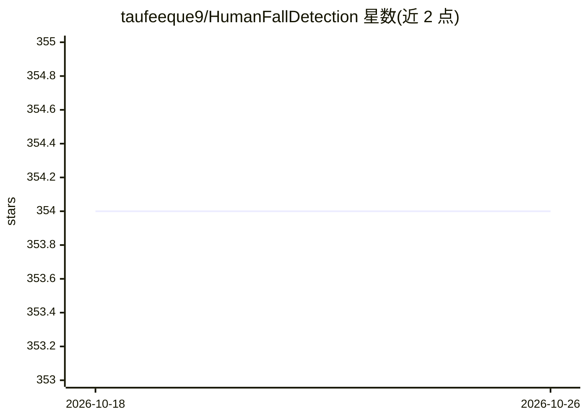

# taufeeque9/HumanFallDetection

⭐ 354 · Python · MIT · 推送 2026-04-29 · [GitHub](https://github.com/taufeeque9/HumanFallDetection) · 组织维护

**多摄像头多人跌倒检测器：姿态估计+LSTM 实时判定跌倒**

基于 Python 的实时跌倒检测系统：在 openpifpaf 人体姿态估计之上扩展多摄像头与多人跟踪，从姿态序列提取 5 个时空特征，经 LSTM 分类器输出“跌倒/未跌倒”二分类结果。支持视频文件或实时摄像头输入，可保存带标注的输出视频，可用参数关闭 CUDA 改用 CPU。模型使用 UP-Fall Detection 数据集训练，附带下载数据集的 Colab 笔记本。以源码仓库形式提供，pip 安装依赖后运行 fall_detector.py。

## 筛选速览

| 维度 | 判定 | 备注 |
|---|---|---|
| AI 角色 | `ai-native` | 本体是模型或模型工具 |
| 许可风险 | `permissive` | MIT |
| 部署形态 | `library` | 以包/库形式分发 |
| 模型依赖 | — | README 未给出锁定关系 |
| 硬件要求 | — | 无带数字的原话,不猜 |
| 安装摩擦 | `medium` | 含编译或系统依赖之一 |
| 成熟度 | — | 结构信号不足 |

## 能力要点

- openpifpaf 姿态估计 + 多摄像头多人跟踪
- LSTM 分类器输出 Fall/No Fall 二分类
- 支持视频文件与实时摄像头输入，可保存输出视频
- 提供 UP-Fall Detection 数据集下载与编译的 Colab 笔记本

## 适用场景

- 用单个或多个摄像头实时监测老人跌倒
- 对已有视频文件批量做跌倒检测
- 基于 UP-Fall Detection 数据集复现或扩展 LSTM 跌倒检测研究

## 场景标签

`目标检测` · 领域:感知与多模态

## 证据(README 行号)

> L2: We augment human pose estimation
> L4: neural network to predict two classes: “Fall” or “No Fall”. From the poses, we extract five temporal and spatial

## 星数曲线

2026-10-18 354 → 2026-10-26 354（+0）

---
*卡片 v1 · prompt 1.4 · 生成 2026-10-21 · 置信度 high · 依据 README sha `5fec84b81e90` · [字段定义](../../DATASET.md)*
