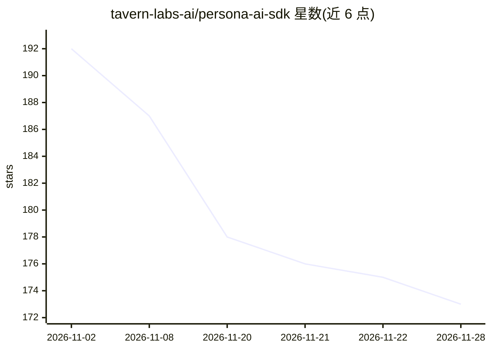

# tavern-labs-ai/persona-ai-sdk

⭐ 173 · TypeScript · MIT · 推送 2026-11-02 · [GitHub](https://github.com/tavern-labs-ai/persona-ai-sdk) · [官网](https://www.npmjs.com/package/ai-persona-sdk) · 组织维护

**给开发者的 AI 角色人设 SDK：内置人设卡、持久记忆与模型适配器**

TypeScript SDK（npm 包 ai-persona-sdk），面向需要在多轮对话中保持角色一致并持久记忆的应用开发者。分层设计：人设卡（8 张内置角色）、记忆运行时（抽取/溯源/合并/召回/生命周期）、模型生成、持久化（内存/JSON/SQLite）与接口层均可替换。提供 Amazon Bedrock 与 OpenAI 适配器（生成、抽取、嵌入），支持混合使用提供商，并含 SillyTavern 角色卡/聊天记录导入、HTTP 服务适配器与评估辅助工具。需 Node.js 20+ 与 OpenAI API key 或 AWS 凭证。

## 筛选速览

| 维度 | 判定 | 备注 |
|---|---|---|
| AI 角色 | `ai-ecosystem` | LLM/agent 周边工具 |
| 许可风险 | `permissive` | MIT |
| 部署形态 | `library` | 以包/库形式分发 |
| 模型依赖 | locked-api |  |
| 硬件要求 | — | 无带数字的原话,不猜 |
| 安装摩擦 | `low` | 无编译、无系统依赖或容器化 |
| 成熟度 | — | 结构信号不足 |

## 能力要点

- 内置 8 张人设卡（atlas/sage 等），含提示词、特质、问候语与记忆种子
- 记忆运行时覆盖抽取、溯源、合并、召回与关系状态演进
- Bedrock 与 OpenAI 双适配器，生成/抽取/嵌入三个独立端口可混合替换
- SillyTavern 角色卡与 JSONL 聊天记录导入兼容

## 适用场景

- 为聊天/语音/游戏应用接入带持久记忆的 AI 角色
- 在 Bedrock 与 OpenAI 之间灵活切换或混用人格化 LLM 调用
- 把 SillyTavern 角色卡导入自己的应用
- 用内置评估辅助工具检验记忆召回与角色表现

## 场景标签

`提示工程` `Agent 记忆` `聊天机器人` `Agent 框架` · 领域:Agent 开发

## 证据(README 行号)

> L29: `ai-persona-sdk` is a TypeScript SDK for applications where an AI character should remain
> L33: |Layer|Responsibility|Replaceable?|
> L189: Extraction, embeddings, and generation are independent ports. An application can use Bedrock for

## 星数曲线

2026-11-02 192 → 2026-11-28 173（-19）

---
*卡片 v1 · prompt 1.4 · 生成 2026-11-26 · 置信度 high · 依据 README sha `71d750a55516` · [字段定义](../../DATASET.md)*
