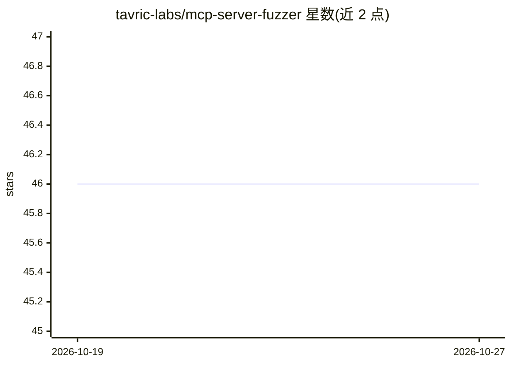

# tavric-labs/mcp-server-fuzzer

⭐ 46 · Python · MIT · 推送 2026-10-23 · [GitHub](https://github.com/tavric-labs/mcp-server-fuzzer) · [官网](https://mcp-server-fuzzer.tavric-labs.net/) · 组织维护

**对运行中的 MCP 服务器做黑盒安全评估的模糊测试工具**

面向 MCP 服务器的黑盒安全评估 CLI：通过 stdio/HTTP/SSE/Streamable HTTP 连接授权目标，发送真实与畸形输入，对响应进行分类（畸形接受、注入回显、崩溃、挂起、错误泄露等），并把 findings.json、运行摘要、会话记录与崩溃复现数据写入磁盘。提供安全审计（工具投毒标记、typosquatting、危险能力组合、注入 oracle）、OAuth 授权审计与本地 stdio 进程运行时观测等可选模式。仅黑盒测试，不读源码、不证明可利用性、不分配 CVE/CVSS。需 Python 3.10+，提供 PyPI 安装与 Docker 镜像。

## 筛选速览

| 维度 | 判定 | 备注 |
|---|---|---|
| AI 角色 | `ai-ecosystem` | LLM/agent 周边工具 |
| 许可风险 | `permissive` | MIT |
| 部署形态 | `self-host` | docker 或自建部署 |
| 模型依赖 | — | README 未给出锁定关系 |
| 硬件要求 | — | 无带数字的原话,不猜 |
| 安装摩擦 | `low` | 无编译、无系统依赖或容器化 |
| 成熟度 | — | 结构信号不足 |

## 能力要点

- 支持 stdio/HTTP/SSE/Streamable HTTP 四种传输连接目标
- 安全审计含工具投毒、typosquatting、隐藏指令、命令/路径/SQL/提示注入 oracle
- 可选 OAuth 授权审计与本地进程运行时行为观测（mcpfz-probe 边车）
- 输出 findings.json、运行摘要、会话记录与崩溃复现，凭证类键值自动脱敏

## 适用场景

- 上线前对我方 MCP 服务器做授权安全评估
- 检测服务器是否接受畸形输入或携带投毒标记的工具描述
- 审计 MCP 服务器的 OAuth 元数据与未认证工具暴露
- 在 CI 中收集 MCP 安全测试证据

## 场景标签

`网络安全` · 领域:学习与行业

## 证据(README 行号)

> L3: Black-box security assessment for live
> L36: The fuzzer connects over stdio, HTTP, SSE, or Streamable HTTP and answers a

## 星数曲线

2026-10-19 46 → 2026-10-27 46（+0）

---
*卡片 v1 · prompt 1.4 · 生成 2026-10-25 · 置信度 high · 依据 README sha `e135fd4480ac` · [字段定义](../../DATASET.md)*
