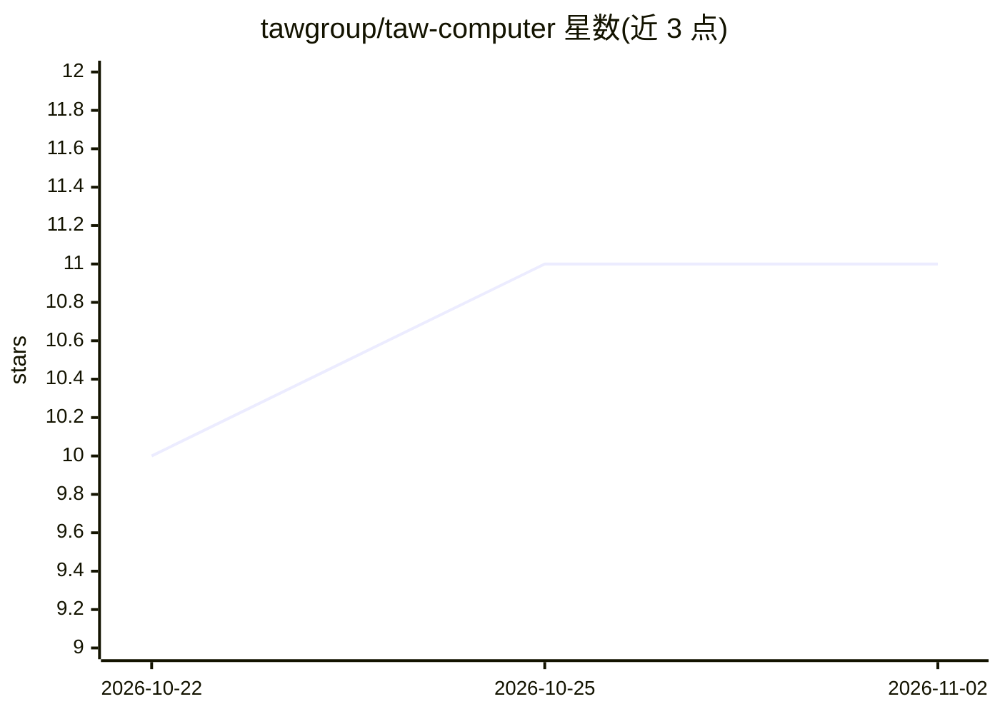

# tawgroup/taw-computer

⭐ 11 · TypeScript · MIT · 推送 2026-05-16 · [GitHub](https://github.com/tawgroup/taw-computer) · 组织维护

**给 AI agent 提供 Docker 内 Ubuntu 桌面沙箱的开源 MCP 服务器**

MCP 服务器，通过 stdio 为 AI 客户端提供 Docker 容器内的完整 Ubuntu 22.04 桌面环境（xfce4 + Xvfb + noVNC + Playwright Chromium），内置 30+ 工具覆盖 VM 管理、Shell 与文件操作、基于 CDP/Playwright 与 Set-of-Mark 标注的浏览器自动化、桌面 GUI 控制。自身不含 LLM 与聊天界面，由外部 AI 客户端（Claude Code、Cursor、Claude Desktop 或任意 MCP 客户端）驱动；支持远程 SSH 部署与快照持久化。运行需 Docker 与 Node.js 20+，每个沙箱约占 4GB 内存、5GB 磁盘。

## 筛选速览

| 维度 | 判定 | 备注 |
|---|---|---|
| AI 角色 | `ai-ecosystem` | LLM/agent 周边工具 |
| 许可风险 | `permissive` | MIT |
| 部署形态 | `self-host` | docker 或自建部署 |
| 模型依赖 | locked-api |  |
| 硬件要求 | — | 无带数字的原话,不猜 |
| 安装摩擦 | `low` | 无编译、无系统依赖或容器化 |
| 成熟度 | — | 结构信号不足 |

## 能力要点

- Docker 隔离沙箱内的完整 Ubuntu 桌面 + Chromium 浏览器
- 30+ 工具：VM 管理、Shell/文件、CDP 浏览器自动化、桌面控制
- Set-of-Mark 提示：截图上为可交互元素编号标注，AI 按编号点击
- noVNC 实时观看 AI 操作，支持快照与远程 SSH 部署

## 适用场景

- 让 Claude Code/Cursor 等 AI 客户端在隔离沙箱里运行命令、装软件、起服务
- AI 在真实浏览器中执行网页操作与 Playwright E2E 测试
- 在远程服务器运行沙箱、本地客户端经 SSH 连接使用

## 场景标签

`浏览器自动化` `GUI 自动化` · 领域:效率与自动化

## 证据(README 行号)

> L16: **taw-computer** is an open-source MCP server that gives AI agents a full Ubuntu desktop inside Docker. Your AI con
> L18: > **No internal LLM. No chat UI. Your AI is the brain. This is the body.**
> L270: OpenInterpreter runs code on your local machine (risky). Open Hands uses its own LLM orchestration. taw-computer i

## 星数曲线

2026-10-22 10 → 2026-11-02 11（+1）

---
*卡片 v1 · prompt 1.4 · 生成 2026-11-01 · 置信度 high · 依据 README sha `d824ded2f4b7` · [字段定义](../../DATASET.md)*
