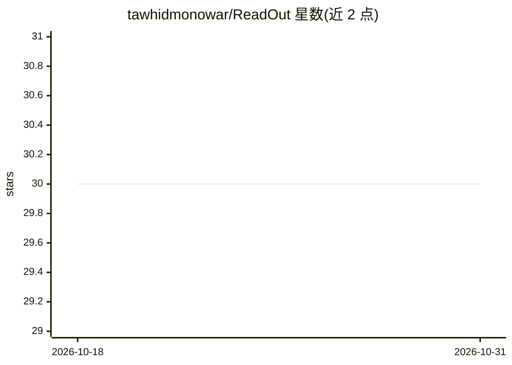

# tawhidmonowar/ReadOut

⭐ 30 · Kotlin · MIT · 推送 2025-11-12 · [GitHub](https://github.com/tawhidmonowar/ReadOut) · 个人维护

**跨平台读书伴侣应用：图书浏览、有声书播放与 AI 摘要**

基于 Kotlin Multiplatform 与 Compose Multiplatform 的 Android/桌面阅读伴侣应用：通过 OpenLibrary 浏览约 2800 万册图书、经 LibriVox 播放 2 万余本免费有声书（桌面端音频播放依赖 Vlcj），支持收藏、检索、明暗双主题与后台播放。AI 功能为图书洞察与摘要：调用 Google Gemini API 生成文字摘要，再经 Google Cloud Text-to-Speech 输出语音摘要，也可由用户输入内容生成。自述仍处于开发早期阶段。

## 筛选速览

| 维度 | 判定 | 备注 |
|---|---|---|
| AI 角色 | `ai-enhanced` | 去掉 AI 部分产品仍成立 |
| 许可风险 | `permissive` | MIT |
| 部署形态 | `None` |  |
| 模型依赖 | — | README 未给出锁定关系 |
| 硬件要求 | — | 无带数字的原话,不猜 |
| 安装摩擦 | `low` | 无编译、无系统依赖或容器化 |
| 成熟度 | `idea` | |

## 能力要点

- 接入 OpenLibrary（图书）与 LibriVox（有声书）API
- Gemini 生成文字摘要 + Cloud TTS 转语音摘要
- Android 与桌面双端、明暗双主题、后台音频播放
- MVI + Clean Architecture 分层实现

## 适用场景

- 在手机或电脑上搜索和浏览图书信息
- 免费收听有声书并收藏喜欢的书
- 为任意图书快速生成文字或语音摘要

## 场景标签

`AI 写作` · 领域:内容生成

## 证据(README 行号)

> L4: ReadOut is a cross-platform reading companion for Android and Desktop, built with Kotlin Multiplatform and Compose M
> L26: - AI-Powered Book Insights
> L63: - Tap the Summarize button to generate an AI-powered text or audio summary.

## 星数曲线

2026-10-18 30 → 2026-10-31 30（+0）

---
*卡片 v1 · prompt 1.4 · 生成 2026-10-26 · 置信度 high · 依据 README sha `03149a1b21a2` · [字段定义](../../DATASET.md)*
