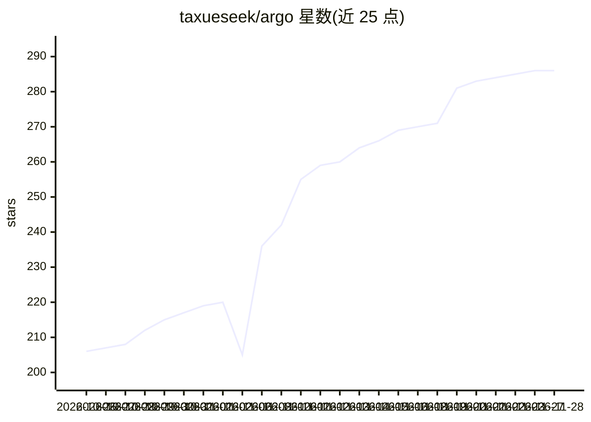

# taxueseek/argo

⭐ 286 · Python · Apache-2.0 · 推送 2026-11-27 · [GitHub](https://github.com/taxueseek/argo) · 组织维护 · 中文 README

**为 AI agent 提供多引擎搜索与证据核验的元搜索引擎**

开源元搜索、网页抓取与证据核验引擎，嵌入 AI agent 使用：按领域（学术/金融/代码/新闻/本地文件）与 18 种语言路由查询至数百个来源，无 API key 时回退到免 key 与本地引擎，并基于全文抓取对事实打分核验（--verify/--numverify）而非仅信任搜索摘要。提供 19 个 MCP 工具、CLI、DeepSeek Harness 插件与浏览器 Workbench UI；需要 Python 3.9+ 与 Node.js 18+，可选多个 API key 提升质量。

## 筛选速览

| 维度 | 判定 | 备注 |
|---|---|---|
| AI 角色 | `ai-ecosystem` | LLM/agent 周边工具 |
| 许可风险 | `permissive` | Apache-2.0 |
| 部署形态 | `library` | 以包/库形式分发 |
| 模型依赖 | — | README 未给出锁定关系 |
| 硬件要求 | — | 无带数字的原话,不猜 |
| 安装摩擦 | `low` | 无编译、无系统依赖或容器化 |
| 成熟度 | — | 结构信号不足 |

## 能力要点

- 数百来源、18 语言查询路由与 RRF 多引擎融合
- 免 key/本地引擎回退，API key 可选
- --verify 全文抓取与 --numverify 数值交叉核验
- 19 个 MCP 工具、CLI 与 DSH 插件三种接入方式

## 适用场景

- 让 Claude Code、Cursor 等 agent 通过 MCP 获得多源搜索与证据核验
- 生成带引用台账的深度研究档案（dossier）
- 本地 markdown/代码笔记的 BM25F+FTS5 混合检索
- 无人值守定时批量检索并控制调用配额

## 场景标签

`网页抓取` `科研工具` · 领域:效率与自动化

## 证据(README 行号)

> L30: **Argo** is an open-source metasearch, web-fetch, and evidence-verification engine that lives inside your AI agent.
> L38:   claude mcp add argo -- npx -y argo-search

## 星数曲线

2026-10-26 206 → 2026-11-28 286（+80）

---
*卡片 v1 · prompt 1.4 · 生成 2026-11-28 · 置信度 mid · 依据 README sha `7639dbfd0f35` · [字段定义](../../DATASET.md)*
