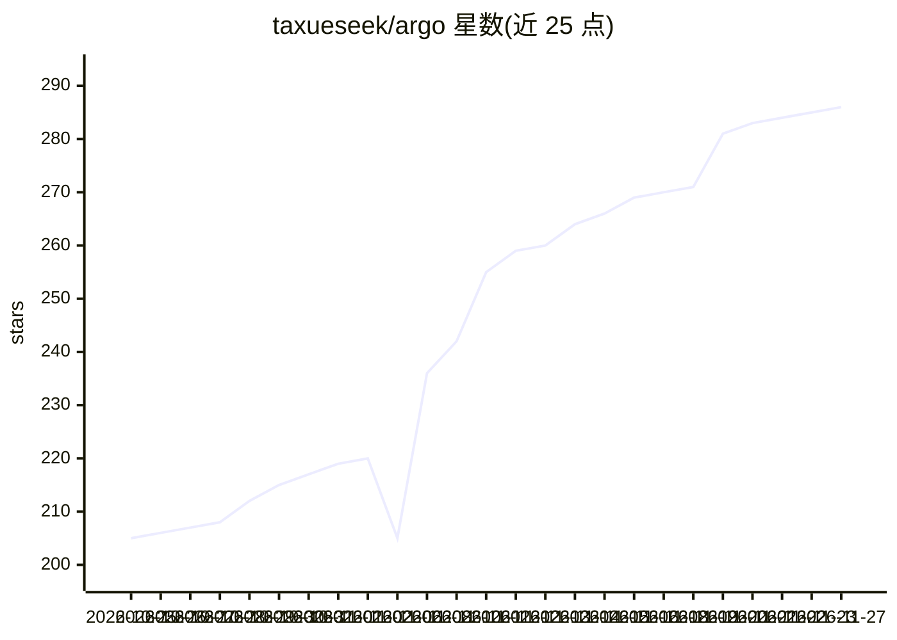

# taxueseek/argo

⭐ 286 · Python · Apache-2.0 · 推送 2026-11-26 · [GitHub](https://github.com/taxueseek/argo) · 组织维护 · 中文 README

**为 AI agent 提供跨 300+ 源、18 语言的元搜索与证据核验**

Argo 是运行在 AI agent 内部的开源元搜索、网页抓取与证据核验引擎。按查询的领域与语言路由到数百个来源（web、学术、财经、代码、本地文件、AI 搜索引擎），无 API key 时回退到免 key 与本地引擎；对候选结果按 Selection（域名权威、多引擎共识 RRF、时效、SERP 壳拒绝）与 Absorption（抓取全文后的可读密度、数值交叉核验）双轴打分。提供 fast/auto/deep/budget 四种预算模式，19 个 MCP 工具、CLI 与 DSH 插件三种接入方式，内置浏览器 Workbench UI。需 Python 3.9+ 与 Node.js 18+。

## 筛选速览

| 维度 | 判定 | 备注 |
|---|---|---|
| AI 角色 | `ai-ecosystem` | LLM/agent 周边工具 |
| 许可风险 | `permissive` | Apache-2.0 |
| 部署形态 | `library` | 以包/库形式分发 |
| 模型依赖 | — | README 未给出锁定关系 |
| 硬件要求 | — | 无带数字的原话,不猜 |
| 安装摩擦 | `low` | 无编译、无系统依赖或容器化 |
| 成熟度 | — | 结构信号不足 |

## 能力要点

- 免 key 回退引擎与可选 key 提质，四种预算模式（fast/auto/deep/budget）
- 证据双轴评分：多引擎 RRF 共识 + 全文抓取核验与数值交叉检查（--verify/--numverify）
- 按领域与语言路由：学术/财经/代码/AI 搜索引擎等，深度研究输出结构化 dossier
- 19 个 MCP 工具 + CLI + DSH 插件，3 个独立 Skill（argo/argo-wide-research/local-seek）

## 适用场景

- 给 Claude Code/Cursor 等客户端接入 MCP 搜索工具
- 生成带引用台账与质量门控的深度研究报告
- 本地 markdown 与代码笔记的混合检索
- 无人值守的定时批量搜索任务（配额封顶）

## 场景标签

`网页抓取` `科研工具` · 领域:效率与自动化

## 证据(README 行号)

> L30: **Argo** is an open-source metasearch, web-fetch, and evidence-verification engine that lives inside your AI agent.
> L132: ### 19 MCP Tools
> L138: Argo ships a first-class **DeepSeek Harness (DSH)** plugin (`@taxueseek/argo-dsh`) with three invocation channels 

## 星数曲线

2026-10-25 205 → 2026-11-27 286（+81）

---
*卡片 v1 · prompt 1.4 · 生成 2026-11-27 · 置信度 mid · 依据 README sha `4b8b88ae09e5` · [字段定义](../../DATASET.md)*
