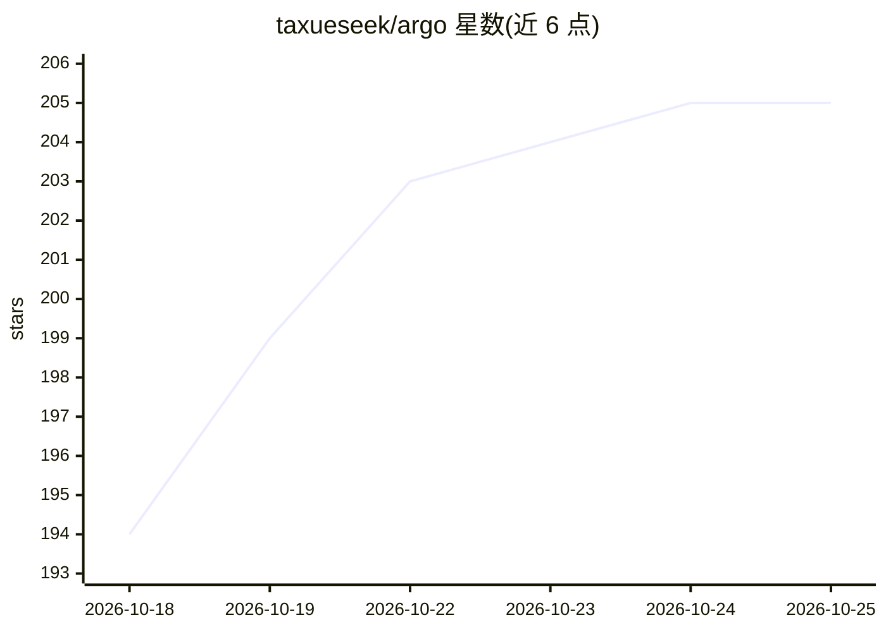

# taxueseek/argo

⭐ 205 · Python · Apache-2.0 · 推送 2026-10-23 · [GitHub](https://github.com/taxueseek/argo) · 个人维护 · 中文 README

**给 Agent 用的搜索与深度研究工具，聚合 264 个搜索源**

面向 AI Agent 的搜索/取证工具，聚合 264 个搜索源（227 个免密钥可用），覆盖 95 个业务领域与 18 种语言，支持本地文件搜索、本地语义搜索（BM25+向量）、登录态搜索与无浏览器 JS 执行四个子技能。检索走语言检测→领域路由→多引擎召回→RRR 融合→证据评分管线，输出含可信度分解的 JSON。接入形态包括 MCP Server、DeepSeek Harness 插件、Skill 文件与 npx 即用。限制：需 Python 3.9+（Node 18+ 用于 npx），Chrome、curl_cffi 等为可选依赖。

## 筛选速览

| 维度 | 判定 | 备注 |
|---|---|---|
| AI 角色 | `ai-ecosystem` | LLM/agent 周边工具 |
| 许可风险 | `permissive` | Apache-2.0 |
| 部署形态 | `library` | 以包/库形式分发 |
| 模型依赖 | locked-api |  |
| 硬件要求 | — | 无带数字的原话,不猜 |
| 安装摩擦 | `low` | 无编译、无系统依赖或容器化 |
| 成熟度 | — | 结构信号不足 |

## 能力要点

- 264 个搜索源，227 个免密钥开箱可用，免费引擎自动保底
- 证据管线：语言检测→领域路由→多引擎召回→RRF 融合→selection/absorption/freshness 评分
- 双层缓存（内存+SQLite），热查询约 10ms
- 四种接入形态：MCP Server / DSH 插件 / Skill 文件 / npx，底层同一套 Python 代码

## 适用场景

- 给 Claude Code、Cursor 等 Agent 客户端挂载 MCP 检索工具
- Agent 做深度研究时多源并行取证并生成带来源账本的报告
- 本机文件与联网搜索合并，一次查询覆盖本地与全网
- 金融、学术、代码等垂直问题直连对应领域源

## 场景标签

`语义搜索` `科研工具` · 领域:知识与检索

## 证据(README 行号)

> L30: **Argo 是一个装在 Agent 里的搜索与深度研究工具，也可以获取相关网页的信息。背后连着 264 个搜索源，覆盖 95 个业务领域，同时支持本地文件的基础搜索能力。在开源搜索项目里，具备非常强大的搜索能力。**
> L63: |**原生一等工具**|开|`argo_search` / `argo_fetch` 等经 `ctx.tools.register` 注册，走 CLI 单发（`--call`）复用 MCP 同一套引擎与守卫，**不依赖 MCP 连
> L154: |**MCP Server**|Agent 常驻挂载|19 个检索工具随时可用，一条命令注入 Claude Code / Cursor / Windsurf / Codex / OpenCode / Cline，写配置前自动备份

## 星数曲线

2026-10-18 194 → 2026-10-25 205（+11）

---
*卡片 v1 · prompt 1.4 · 生成 2026-10-22 · 置信度 mid · 依据 README sha `525144b6fd27` · [字段定义](../../DATASET.md)*
