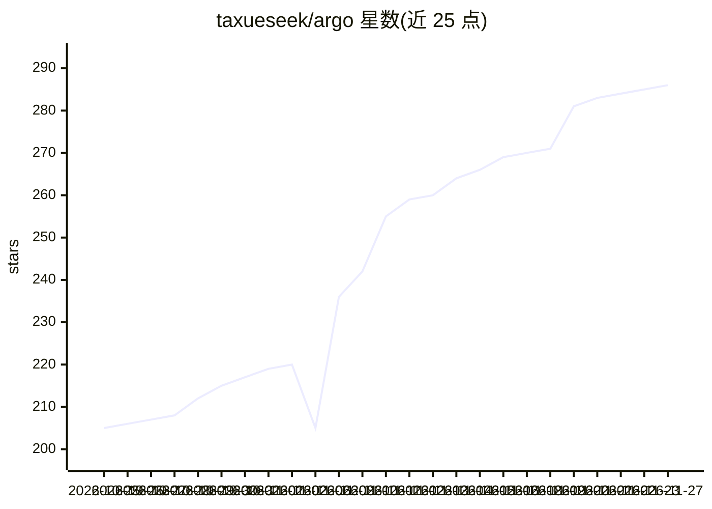

# taxueseek/argo

⭐ 286 · Python · Apache-2.0 · 推送 2026-11-26 · [GitHub](https://github.com/taxueseek/argo) · 个人维护 · 中文 README

**给 AI agent 提供多引擎元搜索与证据核验的 MCP/CLI 工具**

开源元搜索、网页抓取与证据核验引擎，嵌入 AI agent 内使用：按领域与 18 种语言将查询路由到数百个来源（网页、学术、金融、代码、本地文件、AI 搜索引擎），无 API key 时回退到免 key 与本地引擎；对全文抓取的事实打分核验（`--verify`、`--numverify`），而非只信搜索摘要。通过 MCP 服务器、CLI、Agent Skill、DSH 插件四种方式接入，提供 19 个 MCP 工具与浏览器 Workbench UI，含 fast/auto/deep/budget 四种预算模式。

## 筛选速览

| 维度 | 判定 | 备注 |
|---|---|---|
| AI 角色 | `ai-ecosystem` | LLM/agent 周边工具 |
| 许可风险 | `permissive` | Apache-2.0 |
| 部署形态 | `library` | 以包/库形式分发 |
| 模型依赖 | — | README 未给出锁定关系 |
| 硬件要求 | — | 无带数字的原话,不猜 |
| 安装摩擦 | `low` | 无编译、无系统依赖或容器化 |
| 成熟度 | — | 结构信号不足 |

## 能力要点

- 按领域与 18 种语言的查询路由，覆盖 300+ 来源
- 无 key 回退：免 key 与本地引擎开箱可用，可选 key 提升质量
- 全文抓取的证据评分与数值交叉核验（--verify/--numverify）
- 19 个 MCP 工具 + 浏览器 Workbench UI（5 种模式）

## 适用场景

- 让 Claude Code/Cursor 等 agent 获得多来源搜索与事实核验能力
- 生成带来源引用与覆盖缺口分析的研究档案（dossier）
- 无人值守的定时批量检索并控制 API 配额
- 用本地引擎检索本地笔记、markdown 与代码

## 场景标签

`网页抓取` `科研工具` · 领域:效率与自动化

## 证据(README 行号)

> L30: **Argo** is an open-source metasearch, web-fetch, and evidence-verification engine that lives inside your AI agent.
> L38:   claude mcp add argo -- npx -y argo-search

## 星数曲线

2026-10-25 205 → 2026-11-27 286（+81）

---
*卡片 v1 · prompt 1.4 · 生成 2026-11-25 · 置信度 mid · 依据 README sha `53b3d2fd8bc7` · [字段定义](../../DATASET.md)*
