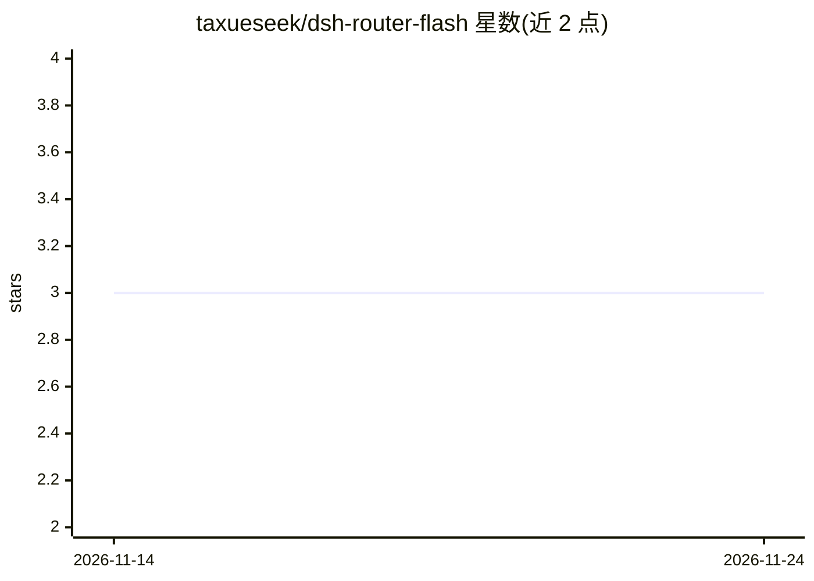

# taxueseek/dsh-router-flash

⭐ 3 · JavaScript · NOASSERTION · 推送 2026-11-07 · [GitHub](https://github.com/taxueseek/dsh-router-flash) · [官网](https://github.com/taxueseek/dsh-router-flash) · 个人维护 · 中文 README

**dsh 网页端的 agent preset 插件：为 DeepSeek V4 Flash 收窄首轮工具面**

以 bundle 补丁层交付的 dsh agent preset 插件，安装后在预设选择器中出现「探索模式」。按模型 id 将会话分为 flash/deepseek/longcat/third-party 四家族并分别路由人设；首轮只向 read/write/edit/glob/grep 加 shell，首次工具调用后放开全目录。另含 HarnessMM 决策重用（run_chain 工具，默认关）。需 DSH ≥0.2.0-rc.2 与 Node.js ≥22.19，经 install.sh 或 dsh plugin 命令安装，重启后生效。

## 筛选速览

| 维度 | 判定 | 备注 |
|---|---|---|
| AI 角色 | `ai-ecosystem` | LLM/agent 周边工具 |
| 许可风险 | `none` | NOASSERTION |
| 部署形态 | `library` | 以包/库形式分发 |
| 模型依赖 | locked-api |  |
| 硬件要求 | — | 无带数字的原话,不猜 |
| 安装摩擦 | `low` | 无编译、无系统依赖或容器化 |
| 成熟度 | `idea` | |

## 能力要点

- 按模型 id 四家族路由（flash/deepseek/longcat/third-party），渠道无关
- 首轮工具面收窄，首次工具调用后放开 26 行全目录
- HarnessMM 决策重用 run_chain（2-8 步链式调用，默认关，不绕过审批）
- 三平台 shell 自动适配（bash/pwsh），零运行时依赖

## 适用场景

- 在 dsh 网页端为 DeepSeek V4 Flash 会话减少首轮 token 消耗
- 接入任意渠道的 DeepSeek V4 Flash 并获得统一引导
- 需要在多步工具调用中批量声明参数化命令链

## 场景标签

`编码 Agent` · 领域:编码与开发

## 证据(README 行号)

> L19: dsh 网页端里模型无关的 agent preset——只看模型 id，首轮收窄工具面，之后就不再多管。
> L24: 一个以 bundle 补丁层交付的 dsh **agent preset**。安装插件即声明一条
> L37: 路由器挂在 `system-prompt/assemble` 接缝上做人设路由。DSH 0.2.2+ 的首轮收窄

## 星数曲线

2026-11-14 3 → 2026-11-24 3（+0）

---
*卡片 v1 · prompt 1.4 · 生成 2026-11-21 · 置信度 mid · 依据 README sha `4945a84858e1` · [字段定义](../../DATASET.md)*
