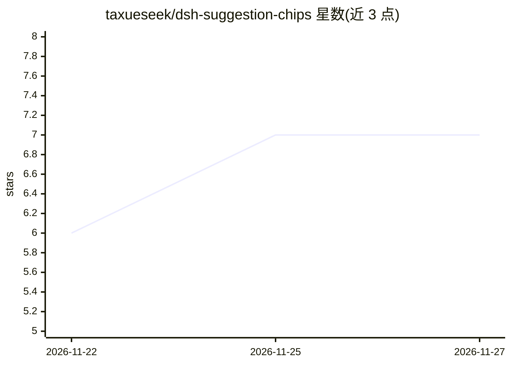

# taxueseek/dsh-suggestion-chips

⭐ 7 · JavaScript · MIT · 推送 2026-11-21 · [GitHub](https://github.com/taxueseek/dsh-suggestion-chips) · [官网](https://github.com/taxueseek/dsh-suggestion-chips#readme) · 个人维护 · 中文 README

**给 DSH 每条回复加建议按钮与 Tab 幽灵文本的插件**

DeepSeek Harness 插件：在每条回复末尾展示最多 5 条可点击的建议胶囊，点击直接发送或经填入按钮先改再发；0.3.0 起支持双形态联动，输入框提供 Tab 幽灵投影并标记已采纳。建议由模型经 suggest_actions 工具给出，未调用时由内置 Level 0 确定性提取器兜底；名单走 presentationMeta 不回灌上下文，调用后经 concludeTurn 结束本轮以省 token。高危操作强制降级为填入草稿不直发。需 DSH 0.1.7+，经 dsh plugin 命令安装。

## 筛选速览

| 维度 | 判定 | 备注 |
|---|---|---|
| AI 角色 | `ai-ecosystem` | LLM/agent 周边工具 |
| 许可风险 | `permissive` | MIT |
| 部署形态 | `None` |  |
| 模型依赖 | — | README 未给出锁定关系 |
| 硬件要求 | — | 无带数字的原话,不猜 |
| 安装摩擦 | `low` | 无编译、无系统依赖或容器化 |
| 成熟度 | — | 结构信号不足 |

## 能力要点

- 五档立场约束避免建议同质化，模型单独标注「推荐」置顶
- 0 额外 Token：名单走 presentationMeta，concludeTurn 直接收轮
- Level 0 确定性提取器兜底（编号选项/确认问句/工程收尾，中英均认）
- 高危操作安全门禁：警示徽标、Tab 只填草稿不发送

## 适用场景

- 读完回复后在下一动作选项间直接点选，不用自己组织语言
- 长会话末尾一键带结论开新会话，省 token
- 需要防误触高危操作的安全填充流程

## 场景标签

`聊天机器人` · 领域:对话与助手

## 证据(README 行号)

> L1: # dsh-suggestion-chips（建议胶囊）
> L7: 给 DeepSeek Harness 的每条回复末尾加一排**可点的建议胶囊（Suggestion Chips）**。点一下，那句话就直接作为你的消息发出去——不用自己打。每条建议右侧还有一个小按钮（输入框图标）：点它只把这句话**
> L38: - **Host 侧**：注册一个 `suggest_actions` 工具。模型写完回复后调用一次，参数里带 1-5 条建议；工具立刻返回并**直接结束这一轮**（宿主的 `concludeTurn()`，可通过 `config

## 星数曲线

2026-11-22 6 → 2026-11-27 7（+1）

---
*卡片 v1 · prompt 1.4 · 生成 2026-11-22 · 置信度 high · 依据 README sha `dd0b26e75818` · [字段定义](../../DATASET.md)*
