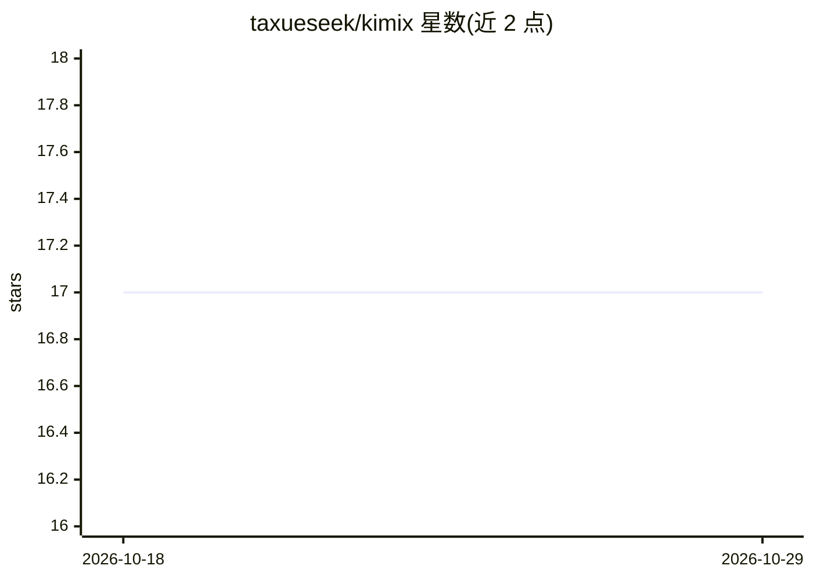

# taxueseek/kimix

⭐ 17 · Rust · Apache-2.0 · 推送 2026-09-15 · [GitHub](https://github.com/taxueseek/kimix) · 个人维护 · 中文 README

**通用终端 AI 代理：TUI 内编辑文件、执行命令、联网搜索**

基于 xai-org/grok-build（Apache-2.0）hard fork 的 Rust 终端 AI 代理，面向 Kimi Code 订阅 API 与 Moonshot 开放平台，内置三家平台注册表，也可经自定义 base_url 接入 OpenAI 兼容网关（DeepSeek/Qwen/vLLM 等）。以全屏 TUI 运行，可读写工作目录文件、执行 shell 命令、联网搜索、管理长时任务；支持无头模式用于脚本/CI，并经 ACP 协议嵌入编辑器。提供缓存命中率记账与压缩后预热机制，子代理带并发控制；npx/npm、安装脚本、Homebrew、cargo 等多种安装途径，单文件二进制分发，零遥测。

## 筛选速览

| 维度 | 判定 | 备注 |
|---|---|---|
| AI 角色 | `ai-native` | 本体是模型或模型工具 |
| 许可风险 | `permissive` | Apache-2.0 |
| 部署形态 | `desktop` | 安装包/桌面程序 |
| 模型依赖 | local-ok | 支持本地模型 |
| 硬件要求 | — | 无带数字的原话,不猜 |
| 安装摩擦 | `medium` | 含编译或系统依赖之一 |
| 成熟度 | — | 结构信号不足 |

## 能力要点

- 全屏 TUI 交互 + 无头模式（-p）+ ACP 协议嵌入编辑器
- 内置 Kimi Code OAuth / Moonshot API Key 平台注册表，另支持 OpenAI 兼容 OSS 网关（DeepSeek/Qwen/vLLM）
- 开模型自动检测与自适应策略（Premium/OpenSource 分类）
- 缓存命中率记账、压缩后预热、子代理并发控制

## 适用场景

- 终端里让 AI 理解代码库、重构、修 bug、写测试
- 多步工作流编排与批量自动化任务
- 用 Kimi Code 订阅在 CLI 中联网调研与数据分析

## 场景标签

`编码 Agent` · 领域:编码与开发

## 证据(README 行号)

> L13: Kimix 是一个通用的终端 AI 代理工具，具有非常优秀的长程任务能力，基于 xai-org/grok-build（Apache-2.0）的 hard fork，
> L16: 它以全屏 TUI 的方式运行，能理解你的工作目录、编辑文件、执行命令、搜索网络，
> L235: Kimix is a general-purpose terminal AI agent — a hard fork of

## 星数曲线

2026-10-18 17 → 2026-10-29 17（+0）

---
*卡片 v1 · prompt 1.4 · 生成 2026-10-29 · 置信度 high · 依据 README sha `424e6aebe90d` · [字段定义](../../DATASET.md)*
