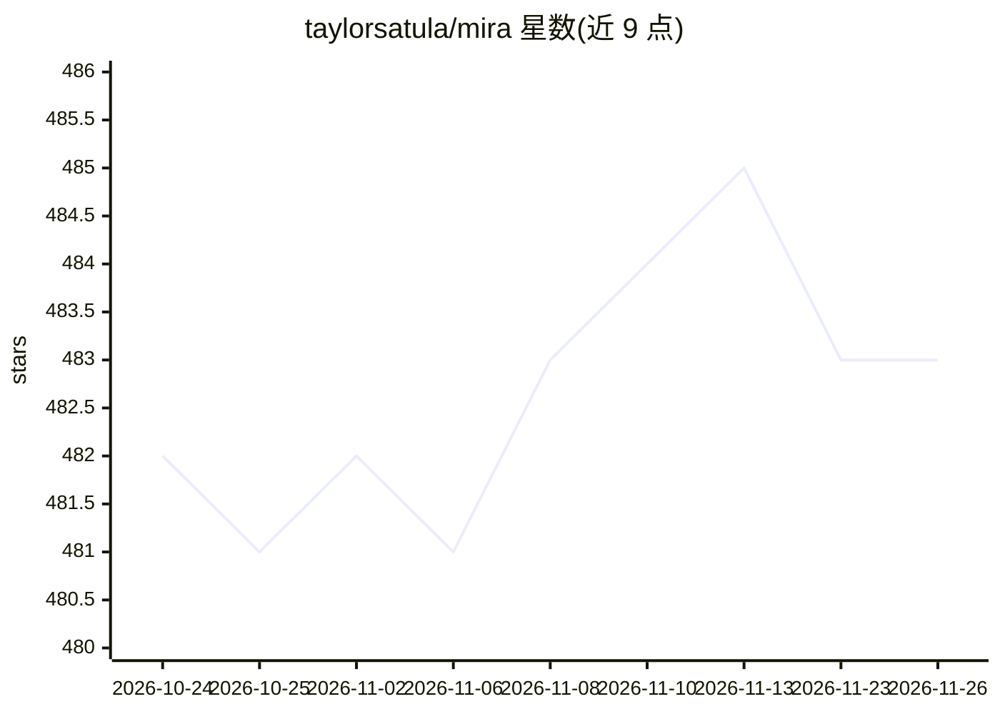

# taylorsatula/mira

⭐ 483 · Python · AGPL-3.0 · 推送 2026-11-23 · [GitHub](https://github.com/taylorsatula/mira) · [官网](https://www.miraos.org) · 个人维护

**自托管 AI 对话实体：以持久记忆与自我上下文管理实现长期连续性**

源自食谱生成器创意、后演化为持续数字实体近似的项目：全生命周期仅一条对话线程，旧对话按机制折叠为第一人称记忆，配合按使用频率衰减的记忆管理、语义检索预加载、加密文档（domaindocs）、每五轮介入的元认知观察层，以及基于反馈累积的系统提示演化（Text-Based LoRA）。工具从文件系统自发现注册，内置邮件、天气、搜索等约 20 个工具并支持自建。LLM 边界 provider-neutral，提供浏览器与终端客户端，另有 miraos.org 托管版本。

## 筛选速览

| 维度 | 判定 | 备注 |
|---|---|---|
| AI 角色 | `ai-native` | 本体是模型或模型工具 |
| 许可风险 | `viral` | AGPL-3.0 |
| 部署形态 | `self-host` | docker 或自建部署 |
| 模型依赖 | — | README 未给出锁定关系 |
| 硬件要求 | — | 无带数字的原话,不猜 |
| 安装摩擦 | `low` | 无编译、无系统依赖或容器化 |
| 成熟度 | `idea` | |

## 能力要点

- 单一永久对话线程，旧内容折叠为第一人称记忆并带模糊连续性引用
- 记忆按使用天数衰减，通过语义相似度、实体枢纽与重排序被动加载
- Subcortical 回合前检索与 Peanut Gallery 每 5 轮的元认知观察双系统
- Text-Based LoRA：每 7 个使用天将行为反馈合成进系统提示

## 适用场景

- 想要一个跨会话记住我偏好与工作历史的个人 AI 助手
- 自托管一个工具可扩展的长期对话代理
- 研究对话折叠、记忆衰减与上下文压缩机制的实现

## 场景标签

`AI 助手` `聊天机器人` `Agent 记忆` · 领域:Agent 开发

## 证据(README 行号)

> L8: Mira accomplishes the end goal of continuity and recall through a blend of asynchronous conversation processing akin
> L22: Memories are discrete synthesized information that is passively loaded into the context window through semantic sim
> L85: The LLM boundary is provider-neutral. Provider-specific request formats, capabilities, failures, and streaming beha

## 星数曲线

2026-10-24 482 → 2026-11-26 483（+1）

---
*卡片 v1 · prompt 1.4 · 生成 2026-11-25 · 置信度 high · 依据 README sha `ba49ca0ed660` · [字段定义](../../DATASET.md)*
