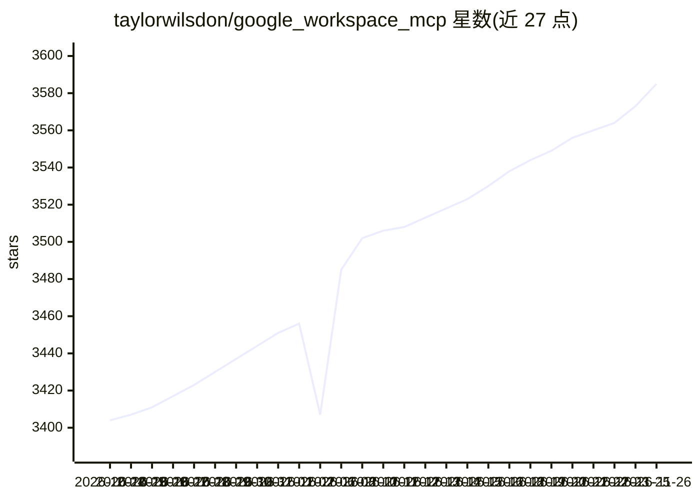

# taylorwilsdon/google_workspace_mcp

⭐ 3,585 · Python · MIT · 推送 2026-11-24 · [GitHub](https://github.com/taylorwilsdon/google_workspace_mcp) · [官网](https://workspacemcp.com) · 个人维护

**让 AI 助手通过 MCP 协议操作全套 Google Workspace 服务的服务器**

将 12 个 Google Workspace 服务（Gmail、Drive、Calendar、Docs、Sheets、Slides、Forms、Tasks、Contacts、Chat、Custom Search、Apps Script）封装为单个 MCP 服务器上的 120+ 工具，支持 OAuth 2.1 多用户认证、三级工具分层（core/extended/complete）、只读模式、无状态容器部署，可通过 stdio 或 streamable HTTP 运行；附带 workspace-cli 命令行工具列出与调用工具。面向需要接入 Google 账号的 AI 助手用户与企业部署者。

## 筛选速览

| 维度 | 判定 | 备注 |
|---|---|---|
| AI 角色 | `ai-ecosystem` | LLM/agent 周边工具 |
| 许可风险 | `permissive` | MIT |
| 部署形态 | `self-host` | docker 或自建部署 |
| 模型依赖 | — | README 未给出锁定关系 |
| 硬件要求 | — | 无带数字的原话,不猜 |
| 安装摩擦 | `low` | 无编译、无系统依赖或容器化 |
| 成熟度 | — | 结构信号不足 |

## 能力要点

- 12 个 Google 服务、120+ 工具接入单个 MCP 服务器
- OAuth 2.1 多用户认证，支持无状态容器部署与外部认证网关透传
- 工具分层与每请求工具集（X-MCP-Toolsets 头）控制上下文窗口
- 内置 CLI（workspace-cli）支持列出与调用工具、磁盘加密令牌缓存

## 适用场景

- 让 Claude Desktop/ChatGPT 等客户端读写 Gmail、日历与 Docs
- 为整个组织集中托管一个带多用户认证的 Workspace MCP 服务器
- 用 CLI 脚本化调用 Google Workspace 工具
- 在无盘写入的容器环境部署服务

## 场景标签

 · 领域:AI 生态/MCP 工具集成

## 证据(README 行号)

> L35: Workspace MCP connects AI assistants to all twelve major Google Workspace services - 120+ tools behind a single MCP
> L146: **Claude Desktop, web & mobile** - run the server in HTTP mode and add it as a **Connector** (Settings → Connector
> L15: By leveraging native OAuth 2.1, stateless deployment capability and external auth server & gateway passthrough auth

## 星数曲线

2026-10-24 3,404 → 2026-11-26 3,585（+181）

---
*卡片 v1 · prompt 1.4 · 生成 2026-11-26 · 置信度 mid · 依据 README sha `b51986b2d295` · [字段定义](../../DATASET.md)*
