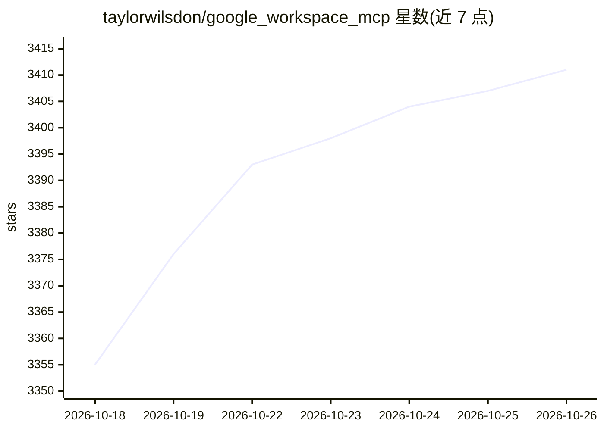

# taylorwilsdon/google_workspace_mcp

⭐ 3,411 · Python · MIT · 推送 2026-10-24 · [GitHub](https://github.com/taylorwilsdon/google_workspace_mcp) · [官网](https://workspacemcp.com) · 个人维护

**让 AI 助手通过 MCP 操控 12 项 Google Workspace 服务的服务器**

通过单个 MCP 服务器向 AI 客户端暴露 Gmail、Drive、Calendar、Docs、Sheets、Slides、Forms、Tasks、Contacts、Chat、Custom Search 与 Apps Script 共 120+ 工具，含 OAuth 2.1 多用户认证、三档工具分层、只读模式、无状态容器部署与 CLI。本地 stdio 与远程 streamable HTTP 双通道，支持 Claude Desktop/Claude Code/ChatGPT 及任意 MCP 客户端接入。需自备 Google Cloud OAuth 凭据；另提供付费托管云实例（$5/月起）与官网文档。

## 筛选速览

| 维度 | 判定 | 备注 |
|---|---|---|
| AI 角色 | `ai-ecosystem` | LLM/agent 周边工具 |
| 许可风险 | `permissive` | MIT |
| 部署形态 | `self-host` | docker 或自建部署 |
| 模型依赖 | — | README 未给出锁定关系 |
| 硬件要求 | — | 无带数字的原话,不猜 |
| 安装摩擦 | `low` | 无编译、无系统依赖或容器化 |
| 成熟度 | — | 结构信号不足 |

## 能力要点

- 覆盖 12 项 Google 服务、120+ 工具的单 MCP 服务器
- OAuth 2.1 多用户认证与外部认证服务器/网关透传
- core/extended/complete 三档工具分层与只读模式
- workspace-cli 命令行直接调用工具，令牌加密缓存

## 适用场景

- 让 Claude/ChatGPT 等 AI 助手读写我的 Gmail、日历和文档
- 团队集中托管一个可连接 AI 客户端的 Workspace 网关
- 用 CLI 脚本化批量操作 Google 服务

## 场景标签

 · 领域:办公套件集成/AI 工具生态

## 证据(README 行号)

> L37: Workspace MCP connects AI assistants to all twelve major Google Workspace services - 120+ tools behind a single MCP
> L158: **VS Code, LM Studio, Open WebUI, and everything else** - any MCP client works over streamable HTTP (recommended) 

## 星数曲线

2026-10-18 3,355 → 2026-10-26 3,411（+56）

---
*卡片 v1 · prompt 1.4 · 生成 2026-10-20 · 置信度 mid · 依据 README sha `cec2c93efa20` · [字段定义](../../DATASET.md)*
