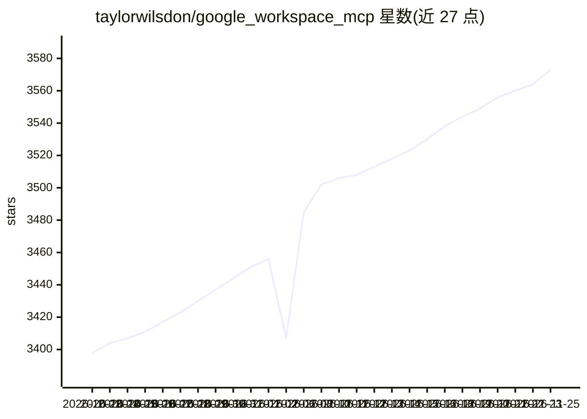

# taylorwilsdon/google_workspace_mcp

⭐ 3,573 · Python · MIT · 推送 2026-11-23 · [GitHub](https://github.com/taylorwilsdon/google_workspace_mcp) · [官网](https://workspacemcp.com) · 个人维护

**让 AI 助手通过 MCP 控制十二项 Google Workspace 服务的服务器与 CLI**

单台 MCP 服务器将 AI 助手接入 Gmail、Drive、Calendar、Docs、Sheets、Slides、Forms、Tasks、Contacts、Chat、Custom Search 与 Apps Script，共 120+ 工具；支持 OAuth 2.1 多用户认证、三级渐进工具分层、只读模式、按请求工具集、无状态容器部署，并可经 stdio 或 streamable HTTP 运行。附 CLI 工具与加密的磁盘令牌缓存，需自备 Google Cloud OAuth 凭据。Google Chat 需一次性 Chat app 配置与 Workspace 账户。

## 筛选速览

| 维度 | 判定 | 备注 |
|---|---|---|
| AI 角色 | `ai-ecosystem` | LLM/agent 周边工具 |
| 许可风险 | `permissive` | MIT |
| 部署形态 | `self-host` | docker 或自建部署 |
| 模型依赖 | — | README 未给出锁定关系 |
| 硬件要求 | — | 无带数字的原话,不猜 |
| 安装摩擦 | `low` | 无编译、无系统依赖或容器化 |
| 成熟度 | — | 结构信号不足 |

## 能力要点

- 十二项 Google Workspace 服务、120+ 工具统一在单个 MCP 服务器后
- OAuth 2.1 多用户认证与无状态容器部署，支持组织级集中托管
- 三级工具分层（core/extended/complete）与只读模式控制上下文
- 附带 workspace-cli 命令行，认证一次后脚本化调用

## 适用场景

- 在 Claude Desktop 或 ChatGPT 中收发邮件、管理日程与文档
- 为整个组织集中托管一个多用户的 Workspace MCP 网关
- 用 CLI 脚本批量列出未读邮件或调用 Workspace 工具

## 场景标签

 · 领域:AI 生态/MCP 服务器

## 证据(README 行号)

> L35: Workspace MCP connects AI assistants to all twelve major Google Workspace services - 120+ tools behind a single MCP
> L10: *Full natural language control over Google Calendar, Drive, Gmail, Docs, Sheets, Slides, Forms, Tasks, Contacts, an

## 星数曲线

2026-10-23 3,398 → 2026-11-25 3,573（+175）

---
*卡片 v1 · prompt 1.4 · 生成 2026-11-23 · 置信度 high · 依据 README sha `f7b6023f8078` · [字段定义](../../DATASET.md)*
