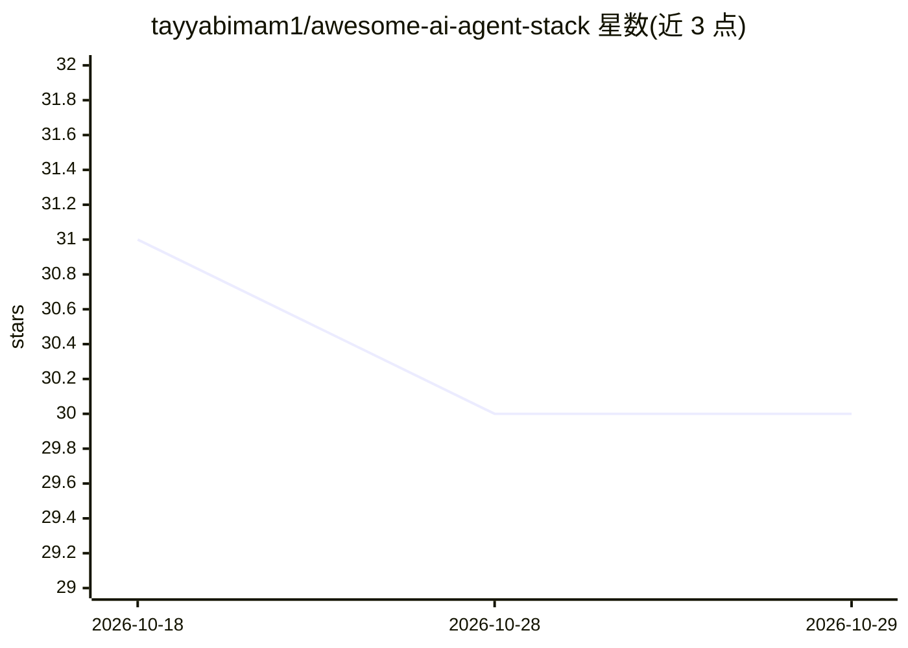

# tayyabimam1/awesome-ai-agent-stack

⭐ 30 · TypeScript · CC-BY-4.0 · 推送 2026-10-28 · [GitHub](https://github.com/tayyabimam1/awesome-ai-agent-stack) · [官网](https://tayyabimam1.github.io/awesome-ai-agent-stack/) · 个人维护

**3,000+ 开源 AI agent 工具分层策展清单，按层与 GitHub 星数组织**

面向构建 AI agent 的开发者维护的 awesome 清单：收录 3,000+ 工具，按 29 个类别组织，覆盖终端编码 agent、IDE/桌面 agent、自主软件工程师、通用 agent 框架、多 agent 编排等层。每个条目需通过机械门槛（真实、公开、未归档、12 个月内有提交），链接经 GitHub API 复检，低星停维项目被剔除。配套网站可搜索、按星数排序，每次 README 变更自动重建；通过仓库 Discussions 接收工具提名与失效链接报告。

## 筛选速览

| 维度 | 判定 | 备注 |
|---|---|---|
| AI 角色 | `ai-knowledge` | 知识聚合/清单类 |
| 许可风险 | `viral` | CC-BY-4.0 |
| 部署形态 | `library` | 以包/库形式分发 |
| 模型依赖 | — | README 未给出锁定关系 |
| 硬件要求 | — | 无带数字的原话,不猜 |
| 安装摩擦 | `low` | 无编译、无系统依赖或容器化 |
| 成熟度 | — | 结构信号不足 |

## 能力要点

- 3,000+ 工具、29 个类别，按 agent 系统分层组织
- 收录门槛：真实、公开、未归档、12 个月内有提交；新增需 1,000+ 星
- GitHub API 复检链接，停维低星项目被剔除
- 配套网站支持搜索与按星数排序，随 README 变更自动重建

## 适用场景

- 为 agent 系统的某一层（编码 agent、编排、RAG、本地 LLM）挑选工具
- 按 GitHub 星数浏览各类别最受关注的项目
- 跟踪每周新增与移除的 AI agent 工具

## 场景标签

`精选清单` · 领域:学习与行业

## 证据(README 行号)

> L13:  The Awesome AI Agent Stack website: 3,000+ tools in 29 categories, ranked by GitHub stars
> L15: **3,000+ tools across 29 categories, ranked by GitHub stars.** Each section is split into sub-groups by what the to

## 星数曲线

2026-10-18 31 → 2026-10-29 30（-1）

---
*卡片 v1 · prompt 1.4 · 生成 2026-10-26 · 置信度 mid · 依据 README sha `f634c59fec83` · [字段定义](../../DATASET.md)*
