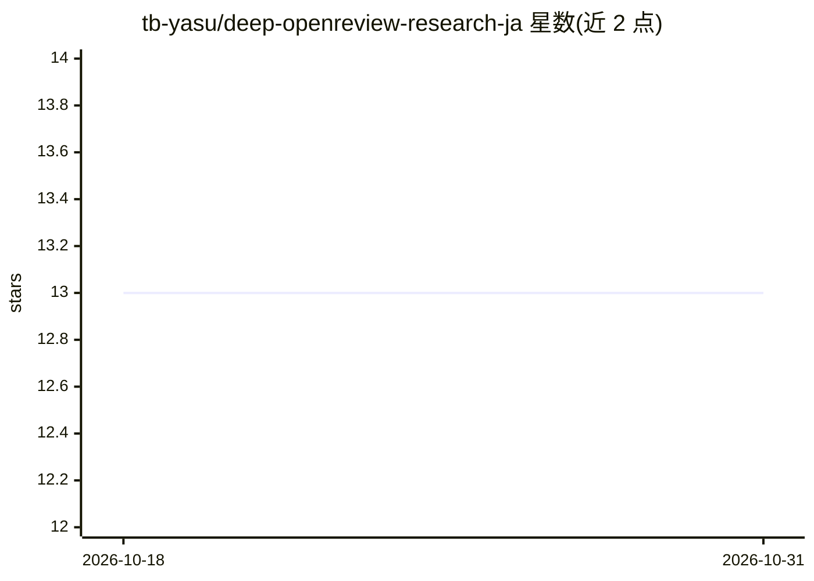

# tb-yasu/deep-openreview-research-ja

⭐ 13 · Python · NOASSERTION · 推送 2025-11-29 · [GitHub](https://github.com/tb-yasu/deep-openreview-research-ja) · [官网](https://note.com/yasu863/n/nec9cbd858c80?sub_rt=share_pw) · 个人维护 · 中文 README

**日本語で OpenReview 論文を検索・評価するサーベイ用 AI エージェント**

OpenReview API と LLM（OpenAI）を組み合わせた論文サーベイ支援エージェント。指定した学会・年の採択論文を自動検索し、自然言語やキーワードで記述した研究興味に基づき、関連性・新規性・インパクト・実用性を LLM が総合評価してランキングと Markdown レポートを生成する。Meta Review、査読詳細、採択理由、Oral/Spotlight 区別などの抽出、ベクトル＋キーワードのハイブリッド検索（OpenAI Embeddings + RRF 統合）、最大10件並列の LLM 評価に対応。開発段階であり評価精度の定量的検証は今後の課題と README に明記されている。Python 3.12+ と OpenAI API キーが必要。

## 筛选速览

| 维度 | 判定 | 备注 |
|---|---|---|
| AI 角色 | `ai-native` | 本体是模型或模型工具 |
| 许可风险 | `none` | NOASSERTION |
| 部署形态 | `library` | 以包/库形式分发 |
| 模型依赖 | — | README 未给出锁定关系 |
| 硬件要求 | — | 无带数字的原话,不猜 |
| 安装摩擦 | `low` | 无编译、无系统依赖或容器化 |
| 成熟度 | `idea` | |

## 能力要点

- 研究興味の自然文記述に基づく LLM による論文評価とランキング
- ベクトル検索＋キーワード検索のハイブリッド検索（RRF 統合）
- Meta Review・査読詳細・採択理由の抽出と詳細レポート生成
- 最大10件並列の LLM 評価と動的フィールド検出（ICLR/NeurIPS/ICML 等）

## 适用场景

- NeurIPS などの採択論文から自分の研究興味に合うものを効率よく発見したい
- 査読内容や採択理由まで含めた論文の詳細分析レポートが欲しい
- キーワードや自然文で学会論文を横断的にサーベイしたい

## 场景标签

`科研工具` · 领域:学习与行业

## 证据(README 行号)

> L10: **Deep OpenReview Research** は、学会の採択論文を自動的に検索・評価し、ユーザーの研究興味に基づいて有益な論文をランク付けするAIエージェントです。OpenReview APIとLLMを組み合わせて、M
> L18: - 🤖 **統合LLM評価**: 1回の呼び出しで関連性・新規性・インパクト・実用性を総合評価

## 星数曲线

2026-10-18 13 → 2026-10-31 13（+0）

---
*卡片 v1 · prompt 1.4 · 生成 2026-10-31 · 置信度 mid · 依据 README sha `62ddc95dfc3a` · [字段定义](../../DATASET.md)*
