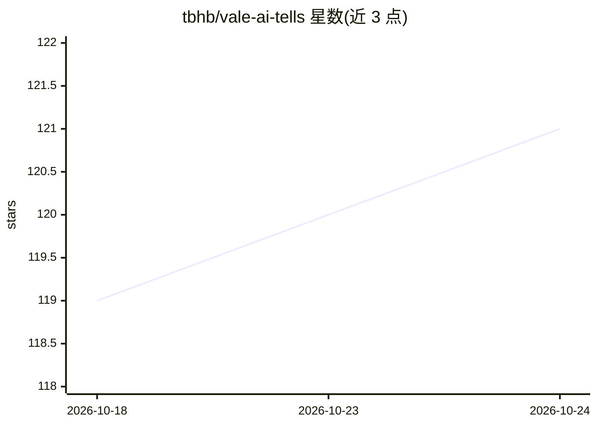

# tbhb/vale-ai-tells

⭐ 121 · Shell · MIT · 推送 2026-10-24 · [GitHub](https://github.com/tbhb/vale-ai-tells) · 个人维护

**检测 AI 文风痕迹的 Vale 规则包，面向技术文档与提交信息**

基于 Vale 的 lint 规则包，用静态规则（默认 error 级）检测 AI 生成文本常见的词汇指纹与结构特征：含 137 个正文规则文件，另有专门针对 git 提交信息的 ai-tells-commits 风格（15 条规则，捕捉自述式前言、尾部辩护从句、gitmoji、代理署名等），可经 pre-commit 的 commit-msg 钩子阻断提交。作者定位为清理 AI 辅助技术文档，明确声明不用于把 AI 文本伪装成人写；对创意写作、营销文案适用性低。规则基于 2024-2025 年相关研究，另有 opt-in 的实验性结构规则包。

## 筛选速览

| 维度 | 判定 | 备注 |
|---|---|---|
| AI 角色 | `ai-knowledge` | 知识聚合/清单类 |
| 许可风险 | `permissive` | MIT |
| 部署形态 | `None` |  |
| 模型依赖 | — | README 未给出锁定关系 |
| 硬件要求 | — | 无带数字的原话,不猜 |
| 安装摩擦 | `low` | 无编译、无系统依赖或容器化 |
| 成熟度 | — | 结构信号不足 |

## 能力要点

- 137 个规则文件覆盖 AI 文风词汇与结构特征，默认 error 级
- ai-tells-commits 提供 15 条提交信息专用规则，可经 pre-commit 钩子阻断提交
- 通过 Vale 包目录以 ai-tells 名称安装，或用 release URL 固定版本
- 声明用途为清理 AI 辅助文档而非伪装人写文本

## 适用场景

- 在文档流水线中用 Vale 标记 AI 风格措辞并要求修改
- 在 commit-msg 钩子中拦截 AI 生成的提交信息
- 审计技术文档中常见的 AI 词汇模式

## 场景标签

 · 领域:开发者工具/文本 lint

## 证据(README 行号)

> L3: A Vale package for detecting linguistic patterns commonly associated with AI-generated prose. Based on 2024-2025 res
> L31: The `ai-tells-experimental` structural rules install as a separate opt-in package with their own steps, described i
> L110: ## Rules included

## 星数曲线

2026-10-18 119 → 2026-10-24 121（+2）

---
*卡片 v1 · prompt 1.4 · 生成 2026-10-23 · 置信度 mid · 依据 README sha `dc9729cde10c` · [字段定义](../../DATASET.md)*
