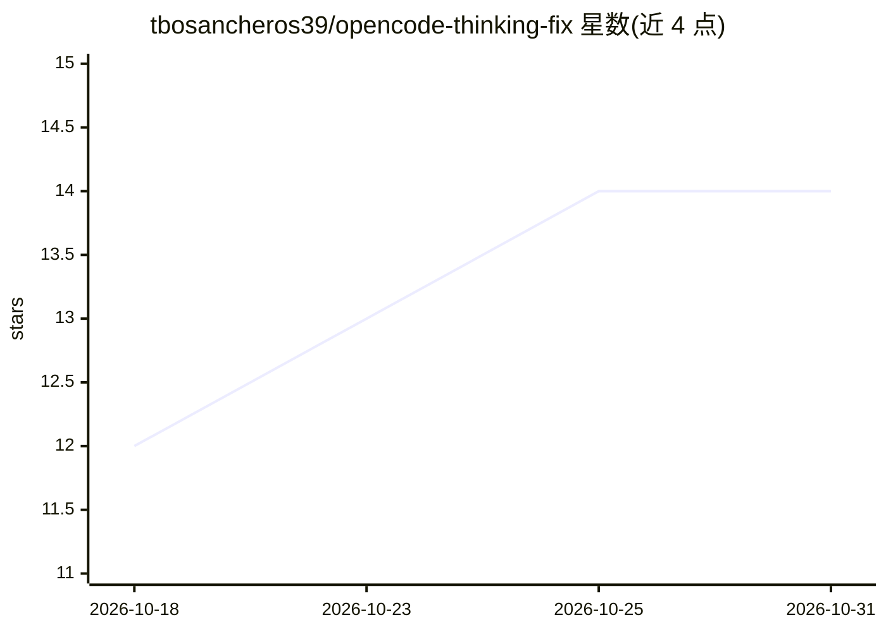

# tbosancheros39/opencode-thinking-fix

⭐ 14 · JavaScript · MIT · 推送 2026-10-23 · [GitHub](https://github.com/tbosancheros39/opencode-thinking-fix) · [官网](https://www.npmjs.com/package/opencode-thinking-fix) · 个人维护 · 中文 README

**修复 OpenCode 多轮对话中 reasoning_content 丢失的插件/代理**

面向 OpenCode 用户的三层修复工具：插件在客户端为缺失的 reasoning_content 字段补空值以避免 400 错误；代理部署在 OpenCode 与上游模型之间，缓存每轮真实推理内容并在后续请求中按正确的槽位回传，按 provider 声明的 reasoningKey（reasoning_content/reasoning_details/reasoning）区分字段名，对拒绝回传的模型默认转发不改动；watchdog 负责代理崩溃后重启。覆盖 DeepSeek、Kimi、GLM、MiMo、MiniMax、OpenRouter 等要求回传推理内容的模型，并提供 proof/ 目录的抓包数据集佐证问题。以 npm 包安装。

## 筛选速览

| 维度 | 判定 | 备注 |
|---|---|---|
| AI 角色 | `ai-ecosystem` | LLM/agent 周边工具 |
| 许可风险 | `permissive` | MIT |
| 部署形态 | `desktop` | 安装包/桌面程序 |
| 模型依赖 | locked-api |  |
| 硬件要求 | — | 无带数字的原话,不猜 |
| 安装摩擦 | `low` | 无编译、无系统依赖或容器化 |
| 成熟度 | — | 结构信号不足 |

## 能力要点

- 代理缓存并按槽位回传真实 reasoning_content，v3 采用原始字节流转发与惰性修补
- v3.1 按 provider 声明 reasoningKey（reasoning_content/reasoning_details/reasoning），避免跨供应商字段污染
- v3.4 对 Z.ai 注入 thinking.clear_thinking:false 以启用 Preserved Thinking
- 插件零配置补空字段阻止 400；watchdog 自动重启代理

## 适用场景

- OpenCode 长会话、重度工具调用中模型遗忘先前推理内容时恢复上下文
- Kimi/DeepSeek 等严格校验 reasoning_content 的模型出现 400 错误时修复请求
- 核实推理内容丢失问题：proof/ 目录提供抓包数据集与复现步骤

## 场景标签

 · 领域:LLM 基础设施/客户端工具

## 证据(README 行号)

> L15: > **Start with the plugin.** It is a zero-config seatbelt that stops the 400 error. Add the proxy when you need the
> L109: - **The plugin** is a tiny note-checker that runs inside OpenCode. It looks at every message and, if a note is mis
> L110: - **The proxy** is a smarter middle-man that sits between OpenCode and the teacher. It **reads the real sticky not

## 星数曲线

2026-10-18 12 → 2026-10-31 14（+2）

---
*卡片 v1 · prompt 1.4 · 生成 2026-10-31 · 置信度 high · 依据 README sha `c7c919078c49` · [字段定义](../../DATASET.md)*
