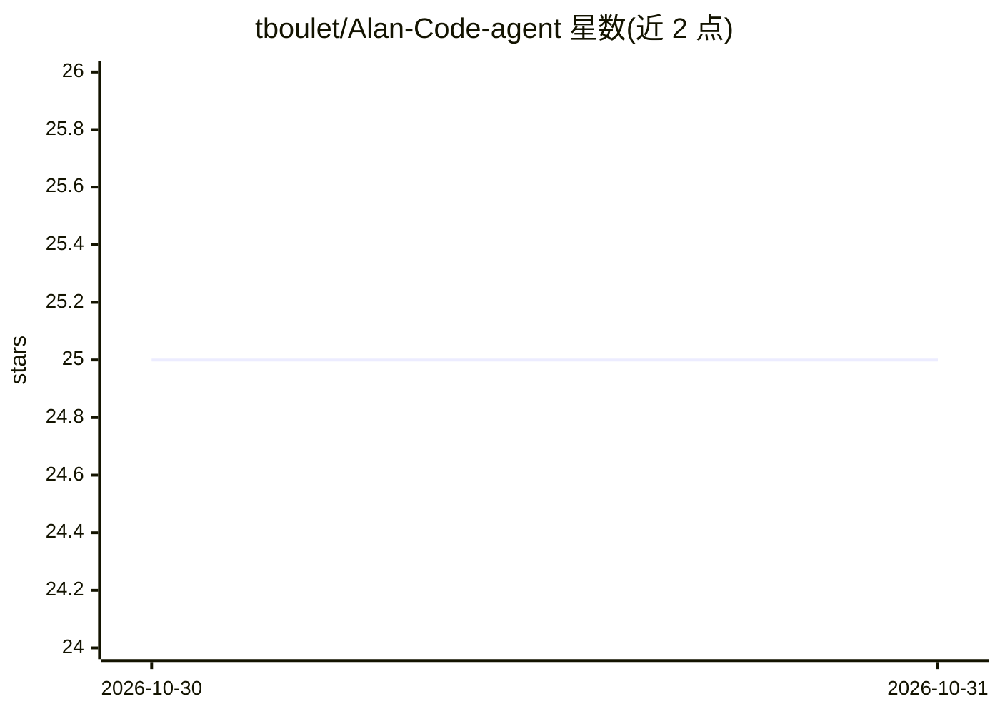

# tboulet/Alan-Code-agent

⭐ 25 · Python · Apache-2.0 · 推送 2026-10-30 · [GitHub](https://github.com/tboulet/Alan-Code-agent) · 个人维护

**开源 Python 编码 agent，类 Claude Code，支持本地模型**

Alan Code 是用 Python 实现的终端编码 agent，功能含异步 agent 循环、内置工具（Bash/文件 IO/Grep/WebFetch 等）、hooks、技能、上下文压缩、跨会话记忆与实时成本跟踪，并提供浏览器 GUI（Chat 与 LLM Perspective 面板）。可作为 CLI、GUI 或 Python 库使用，能构建自动修复循环与编排系统。模型接入支持 Anthropic 原生 SDK、任何 LiteLLM 后端及 vLLM/SGLang/Ollama 本地模型，无原生工具调用的模型有文本回退方案。Linux/macOS 支持，Windows 需 WSL；MCP、子 agent、计划模式尚未实现。

## 筛选速览

| 维度 | 判定 | 备注 |
|---|---|---|
| AI 角色 | `ai-ecosystem` | LLM/agent 周边工具 |
| 许可风险 | `permissive` | Apache-2.0 |
| 部署形态 | `library` | 以包/库形式分发 |
| 模型依赖 | local-ok | 支持本地模型 |
| 硬件要求 | — | 无带数字的原话,不猜 |
| 安装摩擦 | `low` | 无编译、无系统依赖或容器化 |
| 成熟度 | `idea` | |

## 能力要点

- CLI/GUI/Python 库三种使用方式，可构建自动修复循环与编排器
- 支持 Anthropic 原生、LiteLLM 任意后端及 vLLM/SGLang/Ollama 本地模型
- 跨会话记忆（项目级+全局，三种模式）与实时成本/token 跟踪
- LLM Perspective 面板展示归一化后的系统提示与对话

## 适用场景

- 在终端用自然语言驱动编码、改文件与执行命令
- 用本地模型（Ollama/vLLM）离线运行编码 agent
- 基于 Python 库构建自动修测试循环或 agent 编排系统

## 场景标签

`编码 Agent` `Agent 记忆` · 领域:Agent 开发

## 证据(README 行号)

> L11: An open-source python coding agent, inspired by Claude Code. Usable in CLI, GUI, or as a Python library to build up
> L26: - **Broad model support** - Anthropic direct, any LiteLLM backend (OpenAI, OpenRouter, Gemini, ...), or local model
> L120: Alan Code can also be used as a Python library using the `AlanCodeAgent` class, allowing you to build agents or or

## 星数曲线

2026-10-30 25 → 2026-10-31 25（+0）

---
*卡片 v1 · prompt 1.4 · 生成 2026-10-30 · 置信度 mid · 依据 README sha `674ca8f0169e` · [字段定义](../../DATASET.md)*
