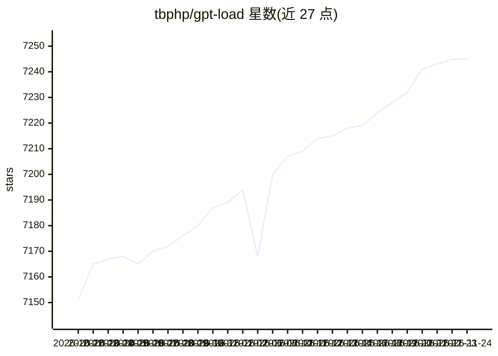

# tbphp/gpt-load

⭐ 7,245 · Go · MIT · 推送 2026-11-22 · [GitHub](https://github.com/tbphp/gpt-load) · [官网](https://gpt-load.com) · 个人维护 · 中文 README

**自托管 AI 网关：为多渠道多凭据接入提供统一入口**

以 Go 编写的自托管 AI 网关，将 API 密钥与订阅账号（Codex/Claude/Antigravity/Grok OAuth）统一管理，应用只需一个 base URL 与 AccessKey 即可访问上游。内置多凭据调度、权重、重试、冷却、黑名单与会话亲和等容错机制，管理 UI 提供健康、路由、日志、用量与成本估算视图，数据存于 SQLite/MySQL/PostgreSQL 并本地加密凭据。部署方式包括 Docker Compose、原生二进制（五平台）与 Windows 安装包；2.0 为重写版本，不能就地迁移 1.x 数据。

## 筛选速览

| 维度 | 判定 | 备注 |
|---|---|---|
| AI 角色 | `ai-ecosystem` | LLM/agent 周边工具 |
| 许可风险 | `permissive` | MIT |
| 部署形态 | `desktop` | 安装包/桌面程序 |
| 模型依赖 | locked-api |  |
| 硬件要求 | — | 无带数字的原话,不猜 |
| 安装摩擦 | `low` | 无编译、无系统依赖或容器化 |
| 成熟度 | `idea` | |

## 能力要点

- 统一管理 API 密钥与订阅账号，客户端保留 OpenAI/Anthropic/Gemini 原生协议
- 多凭据调度与故障隔离：权重、重试、冷却、黑名单、会话亲和
- 嵌入管理 UI 展示健康、日志、用量与成本估算，凭据本地加密
- 支持 Docker Compose、原生二进制与 Windows 服务安装

## 适用场景

- 为多个上游渠道和凭据搭建统一 API 接入点
- 多密钥轮换调度，降低单个凭据过载或失效的影响
- 自托管场景下集中查看请求日志与用量成本

## 场景标签

`模型网关` · 领域:Agent 开发

## 证据(README 行号)

> L5: **A self-hosted AI gateway for multi-channel, multi-credential setups**
> L27: - **One gateway, native protocols** — Manage official APIs, cloud platforms, model services, and compatible relays 

## 星数曲线

2026-10-21 7,151 → 2026-11-24 7,245（+94）

---
*卡片 v1 · prompt 1.4 · 生成 2026-11-22 · 置信度 high · 依据 README sha `a0249bd22a60` · [字段定义](../../DATASET.md)*
