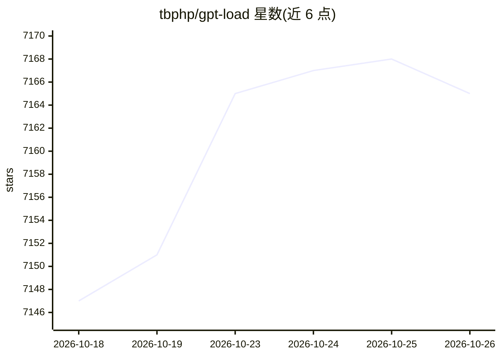

# tbphp/gpt-load

⭐ 7,165 · Go · MIT · 推送 2026-10-25 · [GitHub](https://github.com/tbphp/gpt-load) · [官网](https://www.gpt-load.com) · 个人维护 · 中文 README

**自托管 AI 网关：多渠道多凭据统一接入与调度容错**

用 Go 编写的自托管 AI 网关，面向需要聚合多个上游服务的开发者与团队：应用只需一个 base URL 与一个 AccessKey，即可在管理 UI 中配置 OpenAI/Anthropic/Gemini 等官方 API、云平台、模型服务与兼容中转，客户端保持原生协议。支持 API key 与订阅账号（Codex/Claude/Antigravity/Grok OAuth）两类凭据，内置多凭据加权调度、重试、冷却、黑名单与会话亲和；提供嵌入式 UI 展示健康、路由、日志、用量与成本估算，后端支持 SQLite/MySQL/PostgreSQL 并本地加密凭据。限制：2.0 为完全重写，无法就地迁移 1.x 数据；不支持主密钥轮换。部署方式包括 Docker Compose、原生二进制与 Windows 安装器。

## 筛选速览

| 维度 | 判定 | 备注 |
|---|---|---|
| AI 角色 | `ai-ecosystem` | LLM/agent 周边工具 |
| 许可风险 | `permissive` | MIT |
| 部署形态 | `desktop` | 安装包/桌面程序 |
| 模型依赖 | locked-api |  |
| 硬件要求 | — | 无带数字的原话,不猜 |
| 安装摩擦 | `low` | 无编译、无系统依赖或容器化 |
| 成熟度 | `idea` | |

## 能力要点

- 单入口聚合官方 API、云平台、模型服务与兼容中转，客户端保持 OpenAI/Anthropic/Gemini 原生协议
- API key 与订阅账号（OAuth）统一凭据管理，含加权调度、重试、冷却、黑名单、会话亲和
- 嵌入式管理 UI：渠道/分组/AccessKey 配置，请求日志、用量与成本统计
- 支持 SQLite/MySQL/PostgreSQL，凭据本地加密，提供 Docker Compose、五平台原生二进制与 Windows 服务安装器

## 适用场景

- 把多个 LLM 供应商的 API key 与订阅账号聚合为一个统一入口供应用调用
- 上游渠道过载或失败时自动切换凭据，降低单点故障影响
- 团队查看请求日志、用量与成本估算，按分组下发不同 AccessKey

## 场景标签

`模型网关` · 领域:Agent 开发

## 证据(README 行号)

> L5: **A self-hosted AI gateway for multi-channel, multi-credential setups**
> L27: - **One gateway, native protocols** — Manage official APIs, cloud platforms, model services, and compatible relays 
> L29: - **Scheduling and failure isolation built in** — Multi-credential scheduling, configurable weights, retries, coold

## 星数曲线

2026-10-18 7,147 → 2026-10-26 7,165（+18）

---
*卡片 v1 · prompt 1.4 · 生成 2026-10-20 · 置信度 high · 依据 README sha `643e5d5804c1` · [字段定义](../../DATASET.md)*
