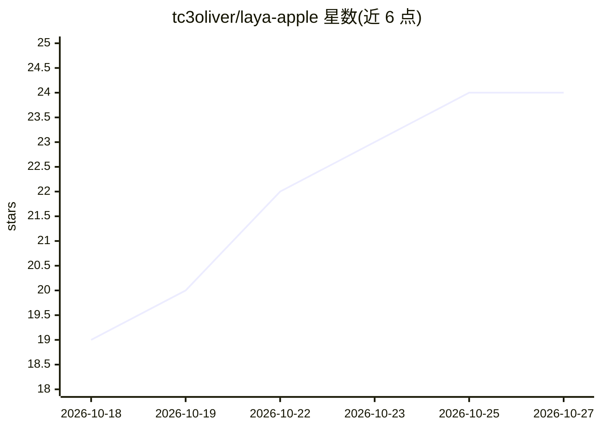

# tc3oliver/laya-apple

⭐ 24 · Python · Apache-2.0 · 推送 2026-10-20 · [GitHub](https://github.com/tc3oliver/laya-apple) · 个人维护 · 中文 README

**Apple Silicon 上经正确性校验的 Laya 异构推理运行时（MLX GPU+ANE）**

在 Mac 上同时使用 MLX GPU 与 Apple Neural Engine 运行上游 Laya 模型的 Python 运行时：短请求路由到通过 FP16 一致性门校验的 ANE 工件，长/多问题请求留在 GPU，execution="workers" 时双引擎并发。提供 Jev 兼容本地服务器（POST /v1/systemone）、预构建 ANE 工件下载（下载后在接收机器上重复校验）、按语言路由的多模型加载与 benchmark 工具 Switchyard。限制：预构建工件仅覆盖 M4 Max + coremltools 9.0 + macOS 26/27 两档平台，其余 Mac 需本地构建（convert extra）；首次 Core ML 加载需设备端编译（约 4.5 分钟）；W8 量化为实验性且默认关闭。

## 筛选速览

| 维度 | 判定 | 备注 |
|---|---|---|
| AI 角色 | `ai-ecosystem` | LLM/agent 周边工具 |
| 许可风险 | `permissive` | Apache-2.0 |
| 部署形态 | `library` | 以包/库形式分发 |
| 模型依赖 | — | README 未给出锁定关系 |
| 硬件要求 | — | 无带数字的原话,不猜 |
| 安装摩擦 | `low` | 无编译、无系统依赖或容器化 |
| 成熟度 | `idea` | |

## 能力要点

- ANE 工件须先通过本机 FP16 一致性门才启用，拒绝静默回退
- 短请求走 ANE、长请求走 GPU 的异构路由，execution="workers" 双引擎并发
- laya-apple serve 提供 Jev API 兼容的本地服务器（POST /v1/systemone）
- 预构建 ANE 工件带 SHA-256/清单/一致性门校验，按 pinned commit 下载

## 适用场景

- 在 Mac 上本地运行 Laya 模型并降低短请求排队延迟
- 让现有 Jev 客户端无改动地指向本地 Mac 服务器
- 校验并复用预构建 ANE 工件，避免本地 PyTorch 转换流程

## 场景标签

`推理引擎` · 领域:训练与推理

## 证据(README 行号)

> L14: laya-apple runs upstream Laya on both engines and picks one per request.
> L33: - **A local stand-in for the Jev API.** `laya-apple serve` answers existing Jev clients with
> L45: pip install 'laya-apple[ane]'   # MLX GPU + the Neural Engine runtime

## 星数曲线

2026-10-18 19 → 2026-10-27 24（+5）

---
*卡片 v1 · prompt 1.4 · 生成 2026-10-27 · 置信度 high · 依据 README sha `0e5d3e4fae39` · [字段定义](../../DATASET.md)*
