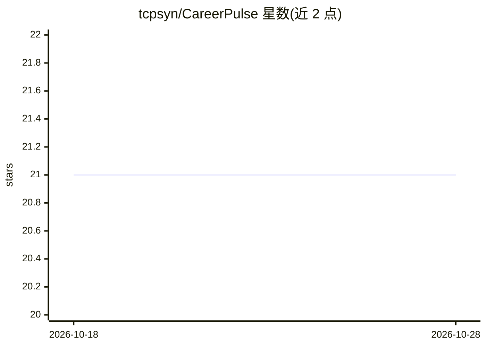

# tcpsyn/CareerPulse

⭐ 21 · JavaScript · NOASSERTION · 推送 2026-04-15 · [GitHub](https://github.com/tcpsyn/CareerPulse) · 个人维护

**自托管求职平台：抓取14个招聘源并用AI评分、生成简历与自动填表**

自托管的求职搜索自动化平台：抓取 LinkedIn、Indeed 等 14 个招聘源，用 AI 按简历对职位打分（0-100，含匹配理由与技能差距分析），生成定制简历与求职信，通过 Chrome 扩展在 Workday/Greenhouse/Lever 等 ATS 表单上 AI 自动填写，并追踪申请全流程。AI 后端支持 Anthropic、OpenAI、Gemini、OpenRouter 或 Ollama 完全本地推理；数据经 Docker 自托管，SQLite 持久化。含薪资计算器、联系人 CRM、面试轮次与日历订阅等功能。

## 筛选速览

| 维度 | 判定 | 备注 |
|---|---|---|
| AI 角色 | `ai-native` | 本体是模型或模型工具 |
| 许可风险 | `none` | NOASSERTION |
| 部署形态 | `self-host` | docker 或自建部署 |
| 模型依赖 | local-ok | 支持本地模型 |
| 硬件要求 | — | 无带数字的原话,不猜 |
| 安装摩擦 | `low` | 无编译、无系统依赖或容器化 |
| 成熟度 | — | 结构信号不足 |

## 能力要点

- 14 个招聘源抓取，含限速、UA 轮换与去重
- AI 匹配打分 0-100，含技能差距分析
- Chrome 扩展对任意 ATS 表单 AI 自动填写，不自动提交
- 5 种 AI 后端可选，支持 Ollama 完全本地推理

## 适用场景

- 在自己机器上聚合各招聘网站职位并按简历匹配度排序
- 为每个职位生成定制简历与求职信并自动填写 ATS 表单
- 追踪从投递到 offer 的完整申请流程与面试安排

## 场景标签

`网页抓取` `AI 写作` `浏览器自动化` · 领域:效率与自动化

## 证据(README 行号)

> L5: CareerPulse is a self-hosted job search automation platform. It scrapes 14 job boards, scores listings against your 
> L12: - **AI-powered matching** — Scores jobs 0-100 against your resume with match reasons, concerns, and skill gap analy

## 星数曲线

2026-10-18 21 → 2026-10-28 21（+0）

---
*卡片 v1 · prompt 1.4 · 生成 2026-10-28 · 置信度 mid · 依据 README sha `901886645ee1` · [字段定义](../../DATASET.md)*
