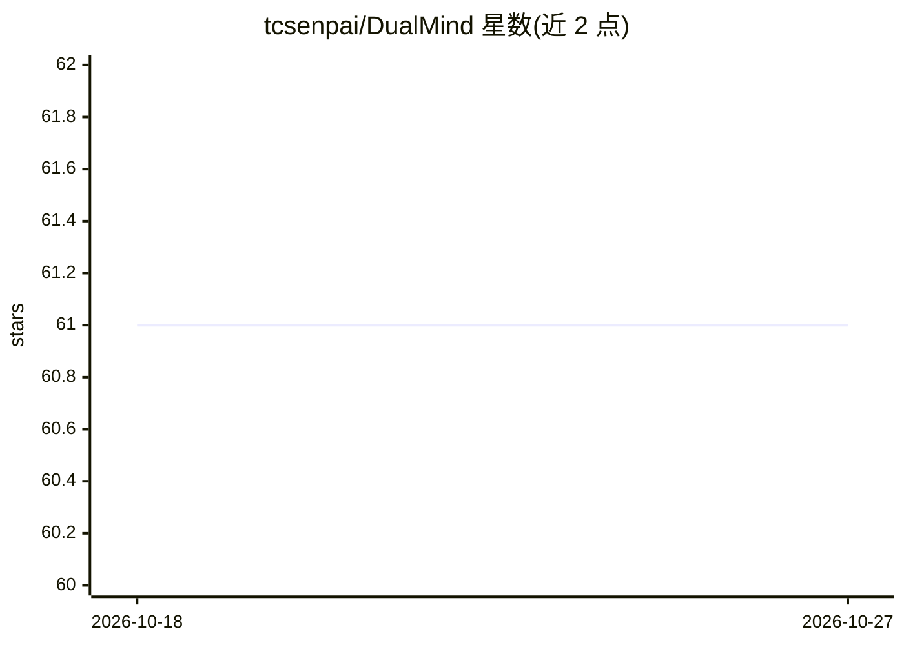

# tcsenpai/DualMind

⭐ 61 · Python · MIT · 推送 2026-09-08 · [GitHub](https://github.com/tcsenpai/DualMind) · 个人维护

**让两个本地模型通过 Ollama 对话的 CLI 模拟器**

Python 编写的命令行 AI 对话模拟器：通过 Ollama API 让两个可配置的模型围绕初始提示进行多轮对话，支持自定义各自系统提示词、交换轮数、token 上限显示与限制、保存对话日志。需要自备 Ollama 端点，通过 .env 配置端点与模型名。README 顶部声明本仓库方案已被 LLM Experiments 中的 Self Conversational AI Experiment 取代。

## 筛选速览

| 维度 | 判定 | 备注 |
|---|---|---|
| AI 角色 | `ai-native` | 本体是模型或模型工具 |
| 许可风险 | `permissive` | MIT |
| 部署形态 | `library` | 以包/库形式分发 |
| 模型依赖 | local-ok | 支持本地模型 |
| 硬件要求 | — | 无带数字的原话,不猜 |
| 安装摩擦 | `low` | 无编译、无系统依赖或容器化 |
| 成熟度 | — | 结构信号不足 |

## 能力要点

- 双模型多轮对话，模型与初始提示可通过 .env 配置
- 每个模型独立的系统提示词文件
- 逐条消息 token 计数与总量限制
- 保存对话日志

## 适用场景

- 观察两个本地模型围绕同一话题的讨论效果
- 对比不同模型在对话中的表现
- 本地隐私优先地生成 AI 对话内容

## 场景标签

`聊天机器人` · 领域:对话与助手

## 证据(README 行号)

> L5: DualMind is an innovative AI conversation simulator that facilitates engaging dialogues between two AI models using 
> L23: This project is privacy oriented and for such reason it uses Ollama as a backend. You need an Ollama endpoint to us

## 星数曲线

2026-10-18 61 → 2026-10-27 61（+0）

---
*卡片 v1 · prompt 1.4 · 生成 2026-10-24 · 置信度 mid · 依据 README sha `e6cea67de84d` · [字段定义](../../DATASET.md)*
