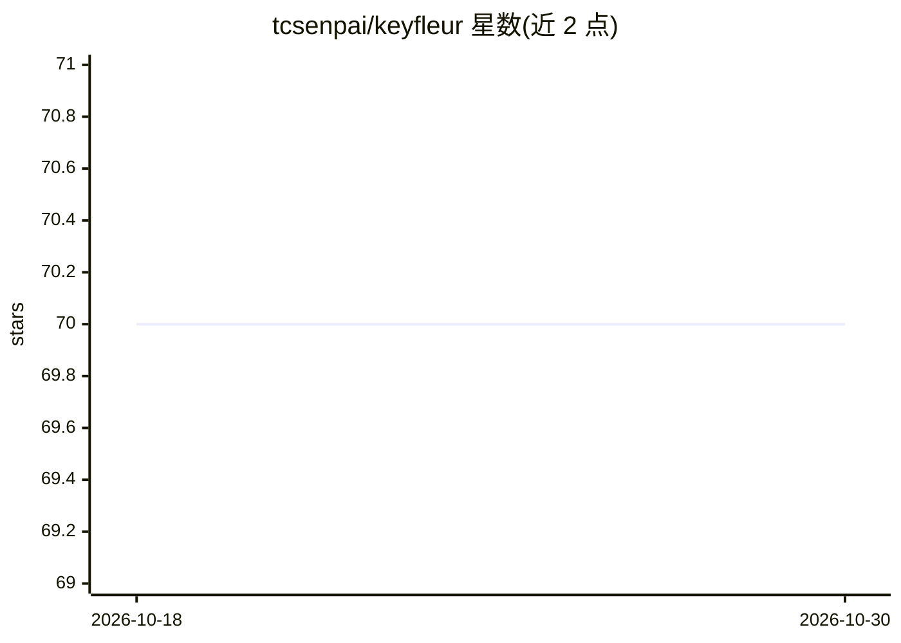

# tcsenpai/keyfleur

⭐ 70 · Python · MIT · 推送 2026-09-08 · [GitHub](https://github.com/tcsenpai/keyfleur) · 个人维护

**生成诗意风格 API key 的 Python CLI 工具**

基于主题词库与结构模式的标识符生成器：通过 --theme 选择语义词汇池（haiku、森林、神话、蒸汽朋克等 12 类），通过 --mode 选择结构格式（俳句 5-7-5、镜像音节、词-数字-词的 sigil 等 9 种），批量生成可读性较高的 API key 或标识符。以 pip 源码安装提供 CLI，参数仅 theme/mode/count 三项；生成过程为词库组合规则，README 未说明使用语言模型。

## 筛选速览

| 维度 | 判定 | 备注 |
|---|---|---|
| AI 角色 | `ai-enhanced` | 去掉 AI 部分产品仍成立 |
| 许可风险 | `permissive` | MIT |
| 部署形态 | `library` | 以包/库形式分发 |
| 模型依赖 | — | README 未给出锁定关系 |
| 硬件要求 | — | 无带数字的原话,不猜 |
| 安装摩擦 | `low` | 无编译、无系统依赖或容器化 |
| 成熟度 | — | 结构信号不足 |

## 能力要点

- 9 种结构模式（俳句、sigil、mantra、quartz 等）
- 12 个主题词库决定词汇池
- CLI 参数：--theme / --mode / --count，支持批量生成
- seed 模式可生成适合作种子值的短 base+hex 标识符

## 适用场景

- 为 API 或用户系统生成可读且有辨识度的 key
- 游戏、世界观设定系统中的命名生成
- 设计与原型中替代随机字符串 ID

## 场景标签

 · 领域:开发者工具

## 证据(README 行号)

> L3: _Keyfleur_ is a poetic API key generator — blending structure and beauty into every token.
> L5: Keyfleur creates keys that are elegant, readable, and never boring.

## 星数曲线

2026-10-18 70 → 2026-10-30 70（+0）

---
*卡片 v1 · prompt 1.4 · 生成 2026-10-24 · 置信度 low · 依据 README sha `259c9b71e2e7` · [字段定义](../../DATASET.md)*
