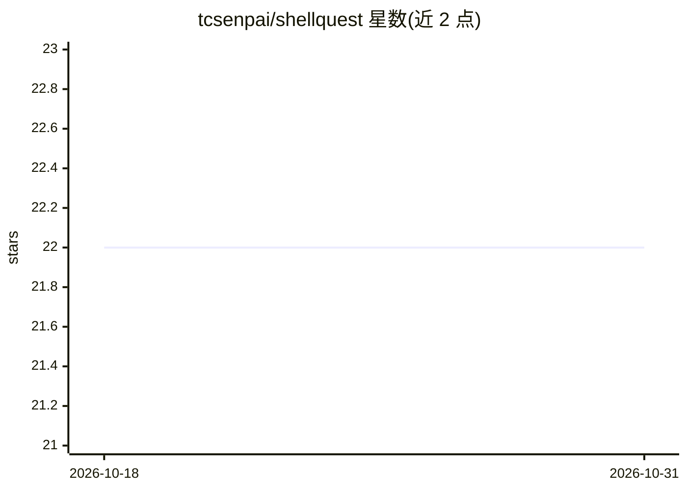

# tcsenpai/shellquest

⭐ 22 · TypeScript · MIT · 推送 2026-09-08 · [GitHub](https://github.com/tcsenpai/shellquest) · 个人维护

**用 Linux 终端命令解谜的文字版密室逃脱游戏与引擎**

基于 TypeScript/Bun 运行的开源文字密室逃脱游戏：玩家在模拟 Linux 终端中通过输入常见命令解决难度递增的谜题关卡。提供玩家档案与自动存档、成就系统、提示命令、进度地图与排行榜；引擎设计为可扩展，用户可按 LEVELS.md 指南自建关卡并分享。README 未描述任何 AI 功能实现细节，仅仓库主题标签含 ai/llm/local-ai。

## 筛选速览

| 维度 | 判定 | 备注 |
|---|---|---|
| AI 角色 | `ai-enhanced` | 去掉 AI 部分产品仍成立 |
| 许可风险 | `permissive` | MIT |
| 部署形态 | `None` |  |
| 模型依赖 | — | README 未给出锁定关系 |
| 硬件要求 | — | 无带数字的原话,不猜 |
| 安装摩擦 | `low` | 无编译、无系统依赖或容器化 |
| 成熟度 | — | 结构信号不足 |

## 能力要点

- 模拟 Linux 终端与常见命令的关卡解谜
- 玩家档案、自动存档与成就系统
- 支持自建关卡并分享的扩展机制
- 提供 /help、/hint、/save 等游戏内命令

## 适用场景

- 以游戏化方式学习或练习 Linux 终端命令
- 自建解谜关卡分享给其他玩家
- 通过成就与排行榜追踪学习进度

## 场景标签

 · 领域:游戏/教育

## 证据(README 行号)

> L4: ShellQuest is an expandable, hackable and open source interactive text-based escape room game and engine that challe
> L10: In ShellQuest, you'll navigate through a series of increasingly difficult levels, each requiring you to use your kn

## 星数曲线

2026-10-18 22 → 2026-10-31 22（+0）

---
*卡片 v1 · prompt 1.4 · 生成 2026-10-27 · 置信度 low · 依据 README sha `7a737eed7451` · [字段定义](../../DATASET.md)*
