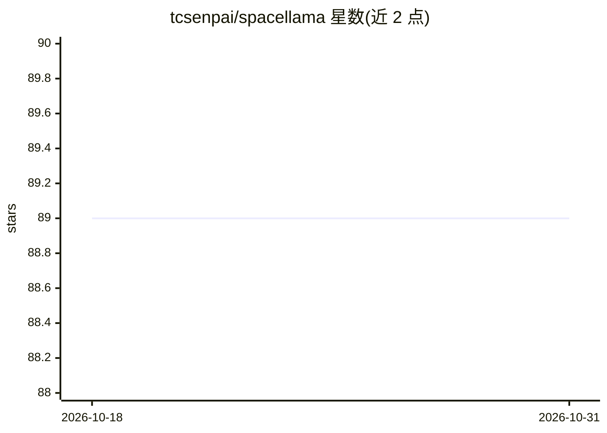

# tcsenpai/spacellama

⭐ 89 · JavaScript · WTFPL · 推送 2026-09-08 · [GitHub](https://github.com/tcsenpai/spacellama) · 个人维护

**调用本地 Ollama 的浏览器网页摘要扩展（侧边栏）**

基于 WebExtensions API 的浏览器扩展：一键抓取当前网页内容，发送到用户配置的 Ollama 端点（默认 localhost:11434，模型默认 llama3.1:latest）生成 Markdown 渲染的摘要，结果显示在侧边栏。支持配置 token 上限与系统提示词，超过上限时递归分块摘要后合并。内容处理经用户配置的端点进行，不发送到其他外部服务器。可从 Mozilla 扩展商店安装，也可用 web-ext 手动构建。

## 筛选速览

| 维度 | 判定 | 备注 |
|---|---|---|
| AI 角色 | `ai-native` | 本体是模型或模型工具 |
| 许可风险 | `viral` | WTFPL |
| 部署形态 | `library` | 以包/库形式分发 |
| 模型依赖 | local-ok | 支持本地模型 |
| 硬件要求 | — | 无带数字的原话,不猜 |
| 安装摩擦 | `low` | 无编译、无系统依赖或容器化 |
| 成熟度 | — | 结构信号不足 |

## 能力要点

- 一键网页摘要，侧边栏内展示（Markdown 渲染）
- 可配置 Ollama 端点、模型、token 上限与系统提示词
- 超长内容递归分块摘要后合并
- 页面内容经本地配置的 Ollama 端点处理

## 适用场景

- 浏览长网页时在侧边栏快速获取摘要
- 使用本地 Ollama 模型做不依赖云端的网页总结
- 自定义提示词与 token 上限控制摘要行为

## 场景标签

`AI 写作` · 领域:内容生成

## 证据(README 行号)

> L5: SpaceLLama is a powerful browser extension that leverages OLLAMA to provide quick and efficient web page summarizati
> L34: 2. Set your preferred OLLAMA endpoint (default is `http://localhost:11434`).

## 星数曲线

2026-10-18 89 → 2026-10-31 89（+0）

---
*卡片 v1 · prompt 1.4 · 生成 2026-10-23 · 置信度 mid · 依据 README sha `2209e7484c61` · [字段定义](../../DATASET.md)*
