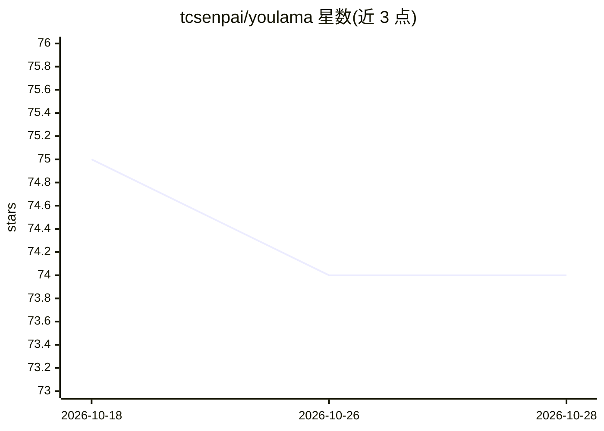

# tcsenpai/youlama

⭐ 74 · Python · 推送 2026-09-08 · [GitHub](https://github.com/tcsenpai/youlama) · 个人维护

**用 Whisper+Ollama 转录并摘要 YouTube 视频的 Web 应用**

基于 Gradio 的 Web 应用，面向终端用户：读取 YouTube 链接或本地音视频文件，先用 faster-whisper 转录（支持多模型选项与自动语言检测，有字幕时优先提取字幕），再由本地运行的 Ollama 生成文本摘要（可选，模型与提示词可配置）。以 Docker 容器部署，要求 NVIDIA GPU 与 CUDA 支持，容器通过 host.docker.internal 连接本机 Ollama。音频最大时长可配置，默认 60 分钟。

## 筛选速览

| 维度 | 判定 | 备注 |
|---|---|---|
| AI 角色 | `ai-native` | 本体是模型或模型工具 |
| 许可风险 | `none` | — |
| 部署形态 | `self-host` | docker 或自建部署 |
| 模型依赖 | local-ok | 支持本地模型 |
| 硬件要求 | — | 无带数字的原话,不猜 |
| 安装摩擦 | `low` | 无编译、无系统依赖或容器化 |
| 成熟度 | — | 结构信号不足 |

## 能力要点

- faster-whisper 转录，支持字幕提取优先与本地文件处理
- 本地 Ollama 摘要，模型与提示词可配置
- Gradio Web 界面，Docker 部署并支持 CUDA

## 适用场景

- 把 YouTube 视频转成易读的文字转录
- 生成本地音视频文件的 AI 摘要
- 在本地 GPU 环境中完成转录与摘要，不依赖云端 API

## 场景标签

`语音识别` `AI 写作` · 领域:内容生成

## 证据(README 行号)

> L3: A powerful web application for transcribing and summarizing YouTube videos and local media files using faster-whispe
> L11: - 📚 AI-powered text summarization using Ollama

## 星数曲线

2026-10-18 75 → 2026-10-28 74（-1）

---
*卡片 v1 · prompt 1.4 · 生成 2026-10-24 · 置信度 high · 依据 README sha `988ef15483fe` · [字段定义](../../DATASET.md)*
