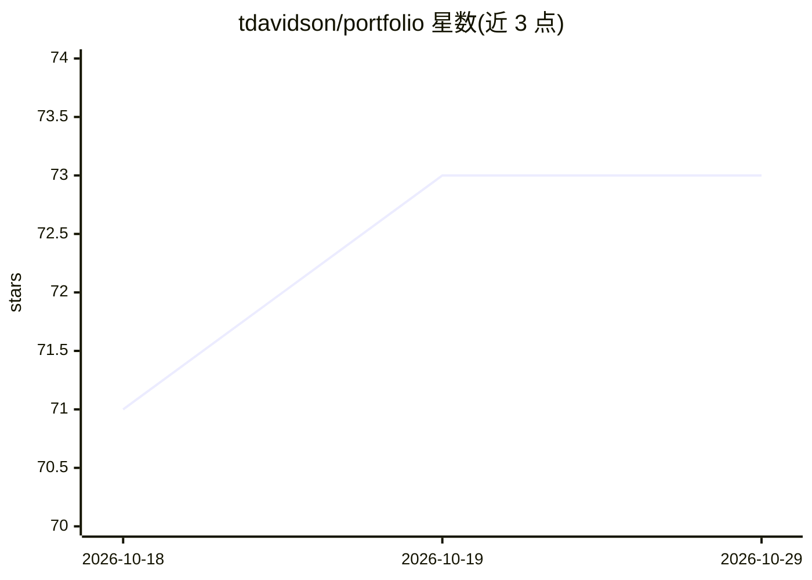

# tdavidson/portfolio

⭐ 73 · TypeScript · Apache-2.0 · 推送 2026-10-28 · [GitHub](https://github.com/tdavidson/portfolio) · [官网](https://hemrock.com/portfolio) · 个人维护

**自托管的风险投资机构运营平台：投前到 LP 报告全流程，接入自有 AI**

面向 VC 机构的一体化运营平台，覆盖项目筛选与评分、尽调清单、投资备忘录起草、组合监控、双录记账的基金核算、carry 建模与 LP 门户报告。AI 用于从创始人邮件更新中提取指标与现金流、生成备忘录和数据分析；支持 Anthropic/OpenAI/OpenRouter 服务端密钥，或通过 MCP 连接用户自己的 Claude/ChatGPT（无需服务端密钥）。提供 Web 应用、REST API 与 MCP 无头访问，Apache 2.0 许可，自部署于 Supabase/Netlify/Vercel，另提供付费部署支持服务。

## 筛选速览

| 维度 | 判定 | 备注 |
|---|---|---|
| AI 角色 | `ai-enhanced` | 去掉 AI 部分产品仍成立 |
| 许可风险 | `permissive` | Apache-2.0 |
| 部署形态 | `library` | 以包/库形式分发 |
| 模型依赖 | locked-api |  |
| 硬件要求 | — | 无带数字的原话,不猜 |
| 安装摩擦 | `low` | 无编译、无系统依赖或容器化 |
| 成熟度 | — | 结构信号不足 |

## 能力要点

- 双录记账自动生成资本账户、报表与 LP 报告
- AI 从邮件更新提取指标/投资/现金流，不确定项进人工审核队列
- MCP 连接 Claude/ChatGPT，无服务端 AI 密钥也可运行
- Web/API/MCP 三种入口统一走访问控制与审计日志

## 适用场景

- 我要替换分散的表格和点工具，统一管理基金运营
- 让 AI 每季度自动从创始人邮件更新提取组合数据
- 给 LP 提供品牌化的安全门户发送报表与文件

## 场景标签

`数据分析` · 领域:效率与自动化

## 证据(README 行号)

> L7: Portfolio is an open-source operating platform for venture capital firms. Take a company from inbound screening and 
> L25: - **Your AI, your data** — Connect Claude or ChatGPT to your own deployment over MCP with a plugin built for your a
> L53: This is a complete investment-firm operations platform you deploy on your own infrastructure — your database, your 

## 星数曲线

2026-10-18 71 → 2026-10-29 73（+2）

---
*卡片 v1 · prompt 1.4 · 生成 2026-10-24 · 置信度 high · 依据 README sha `033639e174c4` · [字段定义](../../DATASET.md)*
