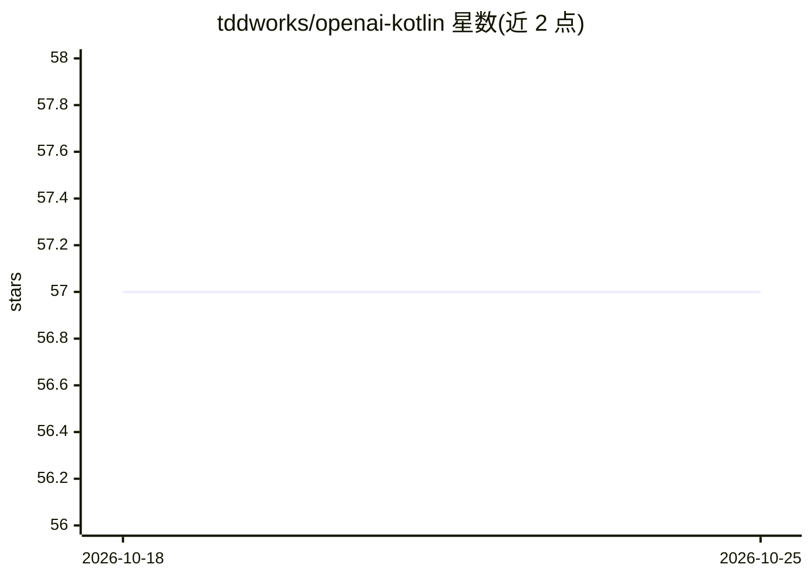

# tddworks/openai-kotlin

⭐ 57 · Kotlin · Apache-2.0 · 推送 2025-12-18 · [GitHub](https://github.com/tddworks/openai-kotlin) · 个人维护

**Kotlin 多平台 LLM 客户端 SDK：统一接入多家 AI 提供商**

面向 Kotlin/Swift 开发者的多平台 LLM 客户端库，以统一接口接入 OpenAI、Anthropic Claude、Google Gemini、Ollama 及自定义提供商，提供多提供商网关模块切换后端。支持 JVM、Android、iOS、macOS 平台，各平台使用原生 HTTP 客户端（Ktor CIO/NSURLSession），提供 Flow 流式输出与类型安全 API。通过 Maven Central/Gradle/Swift Package Manager 分发，采用模块化依赖设计，watchOS/tvOS/Linux/Windows 目标为规划中状态。

## 筛选速览

| 维度 | 判定 | 备注 |
|---|---|---|
| AI 角色 | `ai-ecosystem` | LLM/agent 周边工具 |
| 许可风险 | `permissive` | Apache-2.0 |
| 部署形态 | `None` |  |
| 模型依赖 | local-ok | 支持本地模型 |
| 硬件要求 | — | 无带数字的原话,不猜 |
| 安装摩擦 | `medium` | 含编译或系统依赖之一 |
| 成熟度 | — | 结构信号不足 |

## 能力要点

- 单一统一接口接入 OpenAI/Anthropic/Gemini/Ollama 多提供商
- Kotlin Multiplatform 支持 JVM、Android、iOS、macOS
- Flow 基础的流式聊天补全输出
- 平台原生 HTTP 客户端（Ktor CIO / NSURLSession）

## 适用场景

- 在 Kotlin/Android/iOS 应用中集成多家 LLM 提供商 API
- 通过统一网关在 OpenAI/Claude/Gemini/Ollama 间切换后端
- 连接本地 Ollama 实现离线 LLM 调用

## 场景标签

`模型网关` · 领域:Agent 开发

## 证据(README 行号)

> L14: A comprehensive Kotlin Multiplatform library providing unified access to multiple AI/LLM providers including OpenAI
> L18: - 🔗 **Multi-Provider Support**: OpenAI, Anthropic Claude, Google Gemini, Ollama, and custom providers
> L21: - 🔄 **Unified Gateway**: Switch between providers seamlessly with a single interface

## 星数曲线

2026-10-18 57 → 2026-10-25 57（+0）

---
*卡片 v1 · prompt 1.4 · 生成 2026-10-24 · 置信度 high · 依据 README sha `3df403c531e7` · [字段定义](../../DATASET.md)*
