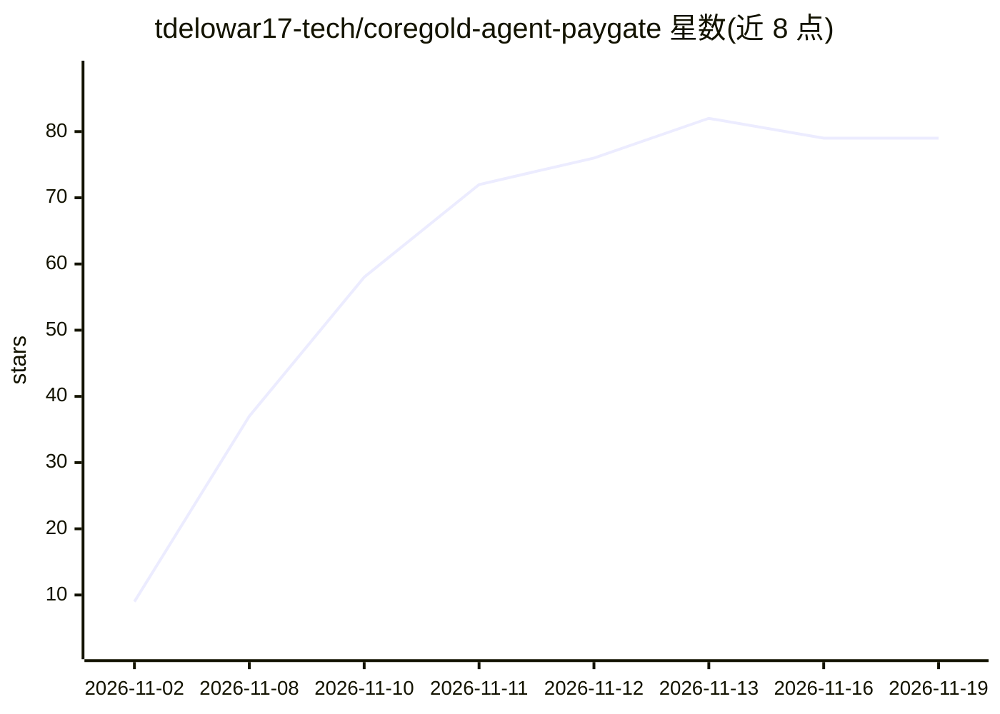

# tdelowar17-tech/coregold-agent-paygate

⭐ 79 · 推送 2026-11-02 · [GitHub](https://github.com/tdelowar17-tech/coregold-agent-paygate) · [官网](https://app.coregold.io/signup?invite_code=ADvlj9b) · 组织维护 · 中文 README

**面向 AI API 订阅付费的海外虚拟商用卡发卡服务推广页**

这是一个商业虚拟卡服务的推广 README，非开源软件：宣传提供欧美 Commercial BIN 的 Visa/Mastercard 企业商用虚拟卡，用于给 Claude 等订阅付费、隔离 Cursor/Copilot 团队额度、承载 Coding Agent 高频微额结算，支持 USDT 充值、单卡限额与销卡退款。仓库不含任何代码或安装运行说明，仅含营销文案与后台注册入口（文末附有一串十六进制字符）。是否可用无法从 README 验证。

## 筛选速览

| 维度 | 判定 | 备注 |
|---|---|---|
| AI 角色 | `ai-enhanced` | 去掉 AI 部分产品仍成立 |
| 许可风险 | `none` | — |
| 部署形态 | `None` |  |
| 模型依赖 | — | README 未给出锁定关系 |
| 硬件要求 | — | 无带数字的原话,不猜 |
| 安装摩擦 | `low` | 无编译、无系统依赖或容器化 |
| 成熟度 | — | 结构信号不足 |

## 能力要点

- 宣传提供欧美 Commercial 号段虚拟 Visa/Mastercard 卡
- 宣称支持单卡额度上限与销卡后余额回流
- 宣称支持 USDT 充值转 USD 余额

## 适用场景

- 为 AI 订阅服务绑定独立虚拟卡
- 为 Agent 高频 API 扣费分配限额卡
- 团队按成员或任务隔离账单

## 场景标签

 · 领域:支付/虚拟卡服务

## 证据(README 行号)

> L7: > 用 **CoreGold** 生成独立的海外 Visa / Mastercard 企业商用卡，原生欧美 Commercial BIN 配合底层 AVS 物理对齐，专打最新一轮的跨国收单精准风控。
> L9: 👉 **立即进入 CoreGold AI 专用开卡后台**

## 星数曲线

2026-11-02 9 → 2026-11-19 79（+70）

---
*卡片 v1 · prompt 1.4 · 生成 2026-11-18 · 置信度 low · 依据 README sha `a892f2861ede` · [字段定义](../../DATASET.md)*
