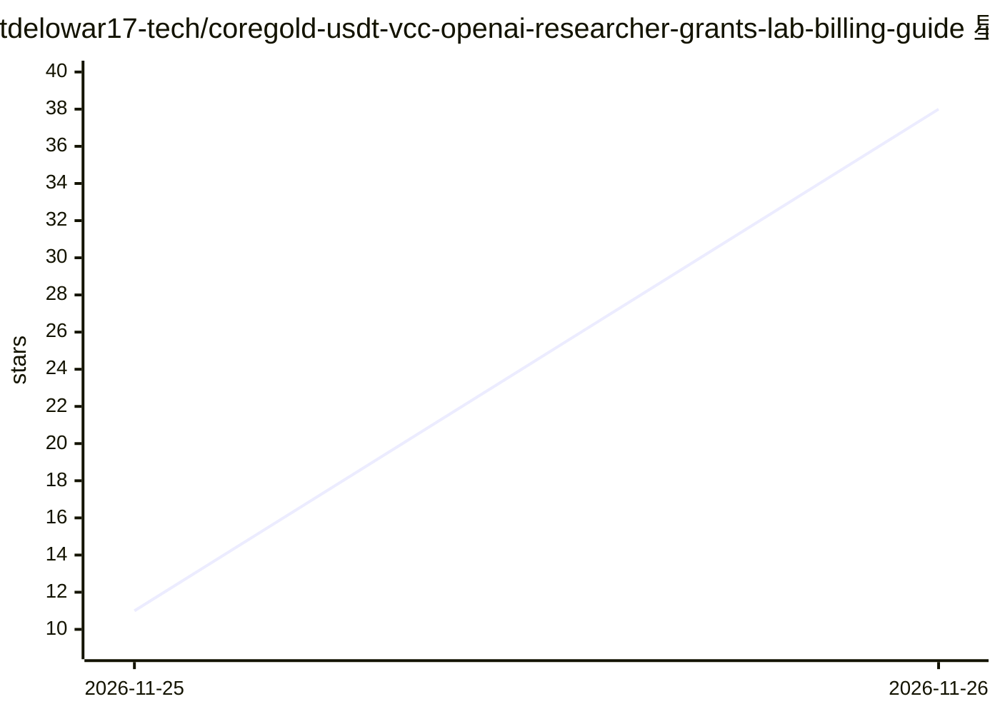

# tdelowar17-tech/coregold-usdt-vcc-openai-researcher-grants-lab-billing-guide

⭐ 38 · 推送 2026-11-23 · [GitHub](https://github.com/tdelowar17-tech/coregold-usdt-vcc-openai-researcher-grants-lab-billing-guide) · [官网](https://app.coregold.io/signup?invite_code=ADvlj9b) · 个人维护 · 中文 README

**面向科研团队的海外虚拟卡（CoreGold）使用教程**

一篇以 Markdown 形式提供的付费虚拟卡服务使用指南：介绍 CoreGold 虚拟信用卡在科研场景中的用法，覆盖注册、USDT（TRC20）充值、选择个人/团队套餐开卡、账单地址 AVS 校验注意事项、按成员分卡对账、结题冻结卡片以及绑定 Apple Pay / Google Pay 的步骤。文中以 OpenAI 科研资助计划为引子，面向高校课题组与硕博团队。内容为单一服务的操作说明，未提供可安装或运行的软件。

## 筛选速览

| 维度 | 判定 | 备注 |
|---|---|---|
| AI 角色 | `ai-knowledge` | 知识聚合/清单类 |
| 许可风险 | `none` | — |
| 部署形态 | `None` |  |
| 模型依赖 | — | README 未给出锁定关系 |
| 硬件要求 | — | 无带数字的原话,不猜 |
| 安装摩擦 | `low` | 无编译、无系统依赖或容器化 |
| 成熟度 | — | 结构信号不足 |

## 能力要点

- 覆盖注册、USDT（TRC20）充值、开卡、绑定数字钱包的完整流程
- 提供个人计划与团队计划两种开卡模式
- 说明账单地址 AVS 校验的一致性要求
- 支持在卡片管理中冻结卡片与余额提现

## 适用场景

- 课题组为海外软件订阅和算力采购安排付款方式
- 按项目或成员分开开卡便于报销对账
- 结题后冻结卡片避免自动续费扣款

## 场景标签

`教程课程` · 领域:学习与行业

## 证据(README 行号)

> L2: 11 月 23 日 OpenAI 正式开放新一轮科研人员资助申请（再发 5 万个名额），高校实验室和硕博团队用海外工具的频率越来越高——聊聊课题组在订软件、买算力、做报销对账时最实用的用卡门道。 Markdown
> L32: > **开卡小技巧**：第一次充 USDT 时，从 OKX 或币安提币务必选 **TRON（TRC20）** 网络，先充一笔小额测试资金走顺“钱包充值 -> 开卡 -> 查账单地址”的完整流程，后面批量给课题组开卡会非常快。

## 星数曲线

2026-11-25 11 → 2026-11-26 38（+27）

---
*卡片 v1 · prompt 1.4 · 生成 2026-11-24 · 置信度 high · 依据 README sha `e1a4e28c59ea` · [字段定义](../../DATASET.md)*
