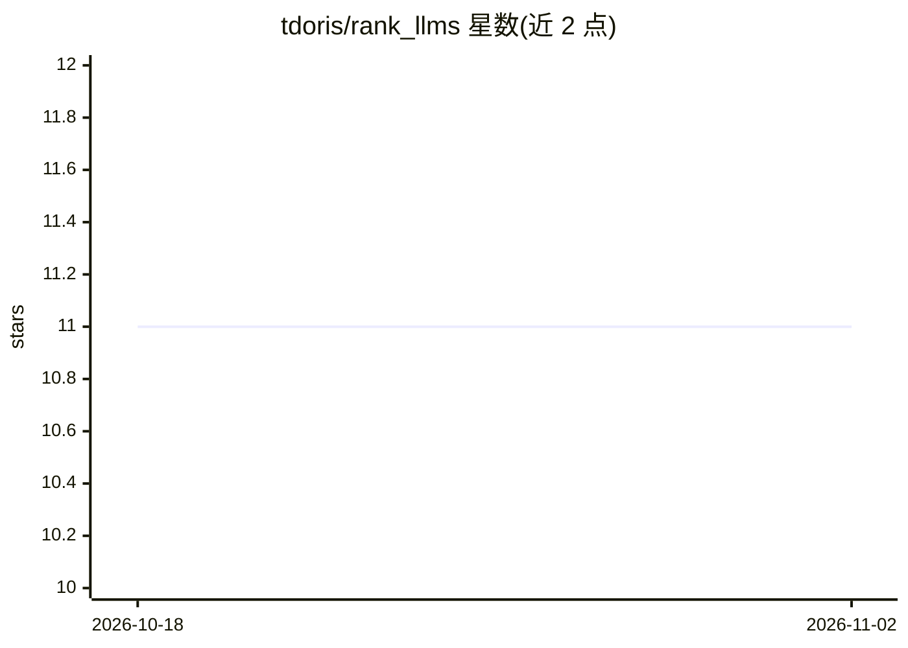

# tdoris/rank_llms

⭐ 11 · Python · 推送 2026-07-05 · [GitHub](https://github.com/tdoris/rank_llms) · 个人维护

**CLI 工具：通过 Ollama 对本地 LLM 做 A/B 对比与 Elo 排名**

Rank-LLMs 是一个命令行评测工具，通过本地 Ollama 运行待测模型，在可自定义的 JSON 提示集上执行 A/B 对比，并由 Claude（默认 claude-opus-4-8，可配置 judge 模型与自一致性投票）判定更优回答。结果以 Elo 评分体系生成排行榜，支持双向排序抵消位置偏差、分类别排名（Wilson 95% 置信区间）、focus/ranksubset 直接对比排名、HTML/JSON 导出与结果归档复用。运行需 Python 3.8+、Ollama 及 Anthropic API key（评测依赖付费 API）。

## 筛选速览

| 维度 | 判定 | 备注 |
|---|---|---|
| AI 角色 | `ai-ecosystem` | LLM/agent 周边工具 |
| 许可风险 | `none` | — |
| 部署形态 | `library` | 以包/库形式分发 |
| 模型依赖 | local-ok | 支持本地模型 |
| 硬件要求 | — | 无带数字的原话,不猜 |
| 安装摩擦 | `low` | 无编译、无系统依赖或容器化 |
| 成熟度 | — | 结构信号不足 |

## 能力要点

- A/B 对比 + AI judge（Claude）评分，双向排序抵消位置偏差
- Elo 排行榜与分类别排名（Wilson 95% 置信区间）
- 可自定义 JSON 提示集与结果归档复用
- 导出 HTML/JSON 报告，--dry-run 预估 API 成本

## 适用场景

- 对比本地 Ollama 模型，选出适合自己任务的模型
- 按编程/推理/通识等分类别构建模型排行榜
- 领域定制提示集做专项评测

## 场景标签

`模型评测` · 领域:评测与运维

## 证据(README 行号)

> L3: Rank-LLMs is a CLI tool for evaluating local LLMs via Ollama. It runs A/B tests on customizable prompt sets—letting 
> L5: Requires: ollama, Anthropic API key.

## 星数曲线

2026-10-18 11 → 2026-11-02 11（+0）

---
*卡片 v1 · prompt 1.4 · 生成 2026-11-01 · 置信度 mid · 依据 README sha `74b2ff6d9004` · [字段定义](../../DATASET.md)*
