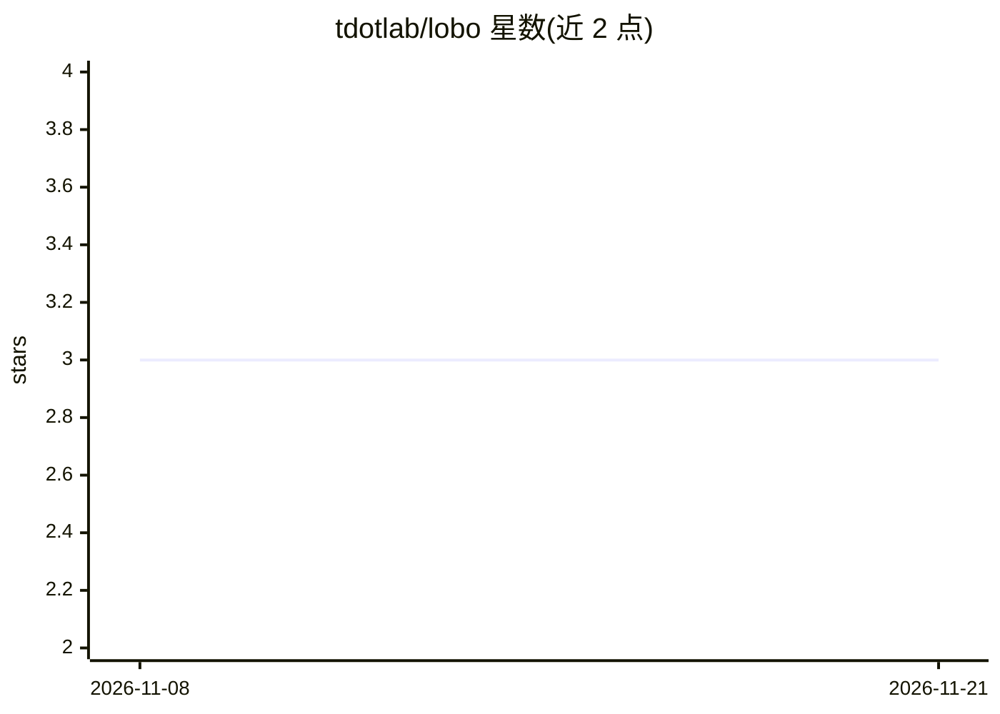

# tdotlab/lobo

⭐ 3 · Python · MIT · 推送 2026-11-06 · [GitHub](https://github.com/tdotlab/lobo) · 个人维护

**自驱运转的持久自主 AI agent 实验项目**

用 Python 标准库（零第三方依赖）手写的实验性持久自主 agent：定时心跳唤醒，维护 curated 笔记与原始事件日志双层记忆，自主决定行动而非执行主人任务，主人主要是观察者。模型可替换（DeepSeek API、OpenRouter 或本地 llama.cpp/Ollama 等 OpenAI 兼容后端），提供收件箱留言、日志回看、备份定时任务等入口，Windows 注册计划任务、macOS 安装 launchd 代理实现登录自启与崩溃重启。实验性质，macOS 路径作者自述未经真机测试。

## 筛选速览

| 维度 | 判定 | 备注 |
|---|---|---|
| AI 角色 | `ai-ecosystem` | LLM/agent 周边工具 |
| 许可风险 | `permissive` | MIT |
| 部署形态 | `None` |  |
| 模型依赖 | local-ok | 支持本地模型 |
| 硬件要求 | — | 无带数字的原话,不猜 |
| 安装摩擦 | `low` | 无编译、无系统依赖或容器化 |
| 成熟度 | `idea` | |

## 能力要点

- 持久 agent：自主心跳唤醒，记忆持久化（notes.md + memory.db）
- 模型可互换：DeepSeek/OpenRouter/本地 llama.cpp 或 Ollama（OpenAI 兼容）
- 零第三方依赖，仅 Python 3.11+ 标准库
- Windows 计划任务/macOS launchd 登录自启、崩溃重启与 6 小时备份

## 适用场景

- 观察一个无人派活、自主生活的 agent 会做什么
- 学习持久 agent 的记忆与连续性机制的实现
- 用本地 Ollama/llama.cpp 跑一个自主 agent

## 场景标签

`Agent 记忆` `Agent 框架` · 领域:Agent 开发

## 证据(README 行号)

> L17:   ├─ model client   → DeepSeek API, OpenRouter, or a local llama.cpp/Ollama server (all OpenAI-compatible)
> L22: The model is interchangeable. The runtime provides the continuity.

## 星数曲线

2026-11-08 3 → 2026-11-21 3（+0）

---
*卡片 v1 · prompt 1.4 · 生成 2026-11-21 · 置信度 high · 依据 README sha `55ed0508ca23` · [字段定义](../../DATASET.md)*
