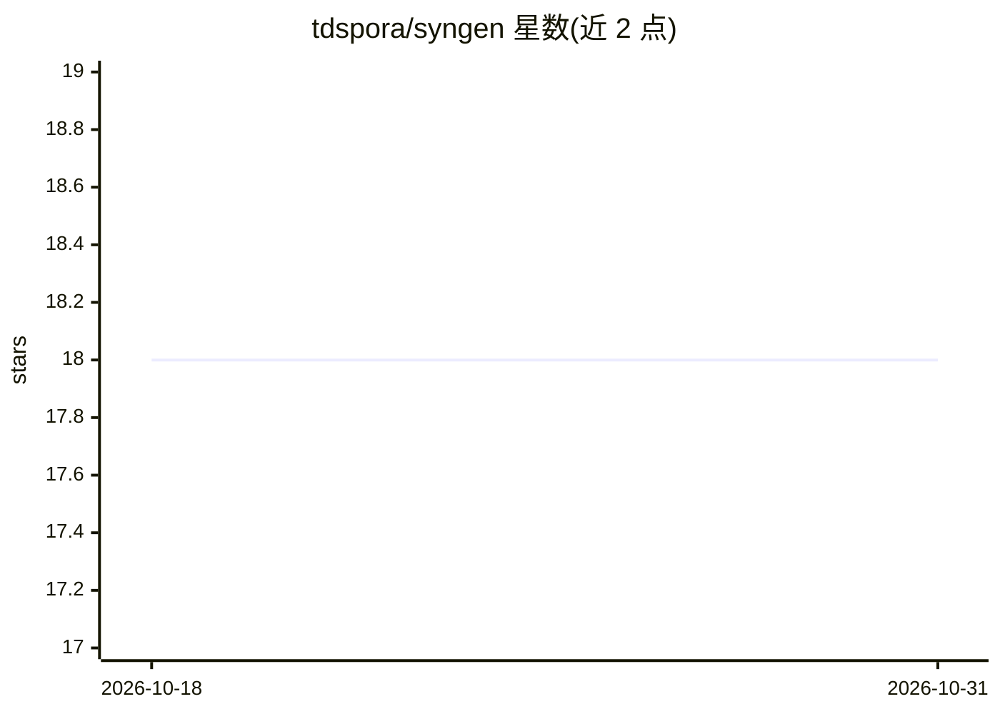

# tdspora/syngen

⭐ 18 · Jupyter Notebook · GPL-3.0 · 推送 2026-10-16 · [GitHub](https://github.com/tdspora/syngen) · [官网](https://tdspora.ai/) · 组织维护

**基于 VAE 的表格合成数据生成工具，供开发者造测试数据**

EPAM 维护的无监督表格数据生成库：以一张真实表为模板，用变分自编码器（VAE）加贝叶斯高斯混合模型学习分布，生成浮点、整数、日期、文本、类别、二进制等多种类型的合成数据；支持通过 YAML 元数据生成共享键的关联表。数据源支持本地 UTF-8 的 CSV/Avro/Excel。训练与推理分为两个 CLI 入口，可选 accuracy/sample 质量报告，支持 fernet 密钥加密原始数据、random_seed 复现与并行生成。需 Python 3.10 或 3.11。

## 筛选速览

| 维度 | 判定 | 备注 |
|---|---|---|
| AI 角色 | `ai-native` | 本体是模型或模型工具 |
| 许可风险 | `viral` | GPL-3.0 |
| 部署形态 | `self-host` | docker 或自建部署 |
| 模型依赖 | — | README 未给出锁定关系 |
| 硬件要求 | — | 无带数字的原话,不猜 |
| 安装摩擦 | `low` | 无编译、无系统依赖或容器化 |
| 成熟度 | — | 结构信号不足 |

## 能力要点

- VAE + 贝叶斯高斯混合模型的表格数据合成
- 支持 CSV/Avro/Excel 输入与多种数据类型
- 通过 YAML 元数据生成多张关联表
- 提供 accuracy/sample 质量报告与 fernet 加密选项

## 适用场景

- 以真实表为模板批量生成测试数据
- 为含外键关系的多表系统生成关联合成数据
- 生成合成数据前用报告核对与原数据的分布一致性

## 场景标签

 · 领域:数据科学/合成数据

## 证据(README 行号)

> L5: EPAM Syngen is an unsupervised tabular data generation tool. It is useful for generation of test data with a given t
> L8: The tool is based on the variational autoencoder model (VAE). The Bayesian Gaussian Mixture model is used to further

## 星数曲线

2026-10-18 18 → 2026-10-31 18（+0）

---
*卡片 v1 · prompt 1.4 · 生成 2026-10-29 · 置信度 mid · 依据 README sha `beb1bff4d39f` · [字段定义](../../DATASET.md)*
