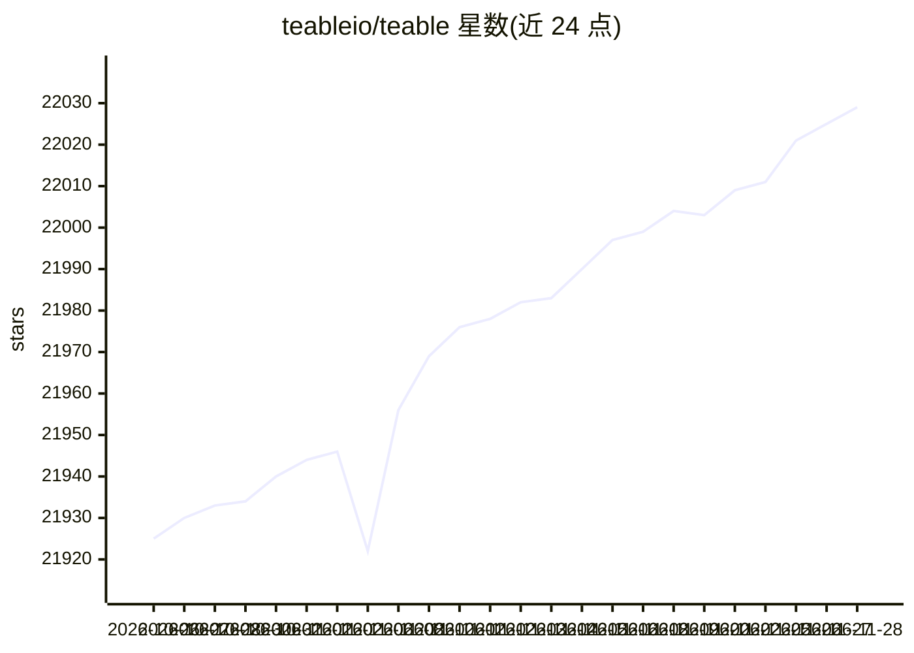

# teableio/teable

⭐ 22,029 · TypeScript · NOASSERTION · 推送 2026-11-27 · [GitHub](https://github.com/teableio/teable) · [官网](https://teable.ai) · 组织维护

**企业 AI 表格平台：数据管理与 AI 工作流、应用构建一体**

以表格界面操作、底层基于 PostgreSQL 的数据协作平台，自托管部署时包含四个组成部分：按会话隔离的 agent 沙箱容器、应用部署平台（每个应用独立容器）、由记录变更/定时/ webhook 触发且含 AI 步骤的工作流引擎、以及带视图/权限/API 的数据库协作平台。AI 功能包括自然语言对话操作数据、App Builder 生成应用并一键部署、批量填充字段。部署方式含云端托管、全功能自托管与无 AI 功能的独立自托管。

## 筛选速览

| 维度 | 判定 | 备注 |
|---|---|---|
| AI 角色 | `ai-enhanced` | 去掉 AI 部分产品仍成立 |
| 许可风险 | `none` | NOASSERTION |
| 部署形态 | `library` | 以包/库形式分发 |
| 模型依赖 | — | README 未给出锁定关系 |
| 硬件要求 | — | 无带数字的原话,不猜 |
| 安装摩擦 | `low` | 无编译、无系统依赖或容器化 |
| 成熟度 | — | 结构信号不足 |

## 动量与使用信号

- 维护:`active` — 距上次 push 1.3 天,年发版 100,40 位贡献者
- 涨星:近 1 天 **+3**(自 20261016 起算)

## 能力要点

- AI 会话在独立沙箱容器中运行，会话结束即销毁
- App Builder 通过自然语言描述生成应用并部署到独立 URL
- 自动化支持记录变更、定时与 webhook 触发并可含 AI 步骤
- 底层为 PostgreSQL，支持表格/看板/日历等多种视图与实时协作

## 适用场景

- 团队在自托管环境中用自然语言分析和管理业务数据
- 描述需求后生成内部应用并直接部署使用
- 基于记录变更配置含 AI 推理步骤的自动化流程

## 场景标签

`工作流自动化` `数据分析` · 领域:效率与自动化

## 证据(README 行号)

> L36: - **A full-featured database collaboration platform on PostgreSQL** — tables, views, permissions, and API.
> L73: |AI features (chat, agents)|✅|✅|❌|
> L135: **Teable puts the agent where the work already happens.** Your data, apps,

## 星数曲线

2026-10-26 21,925 → 2026-11-28 22,029（+104）

---
*卡片 v1 · prompt 1.4 · 生成 2026-11-22 · 置信度 mid · 依据 README sha `1b28d1ec385c` · [字段定义](../../DATASET.md)*
