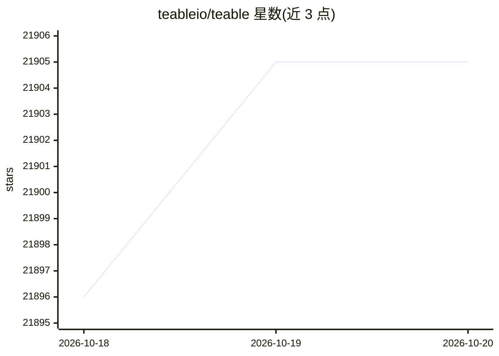

# teableio/teable

⭐ 21,905 · TypeScript · NOASSERTION · 推送 2026-10-19 · [GitHub](https://github.com/teableio/teable) · [官网](https://teable.ai) · 组织维护

**面向企业的 AI 电子表格：数据管理、AI 工作流与应用构建一体**

基于 PostgreSQL 的数据库协作平台，自托管时提供四合一部署：按会话隔离的 agent 沙箱容器、以独立容器运行的应用部署平台、由记录变更/定时/webhook 触发并含 AI 步骤的自动化引擎，以及表格/视图/权限/API 的协作数据库。功能包括自然语言操作数据的 AI Chat、描述需求即由 agent 构建并一键部署的 App Builder、批量填充字段的 AI field filling。提供云端托管与自托管两种形态，独立自托管版不含 AI 功能与应用构建。

## 筛选速览

| 维度 | 判定 | 备注 |
|---|---|---|
| AI 角色 | `ai-native` | 本体是模型或模型工具 |
| 许可风险 | `none` | NOASSERTION |
| 部署形态 | `library` | 以包/库形式分发 |
| 模型依赖 | — | README 未给出锁定关系 |
| 硬件要求 | — | 无带数字的原话,不猜 |
| 安装摩擦 | `low` | 无编译、无系统依赖或容器化 |
| 成熟度 | — | 结构信号不足 |

## 动量与使用信号

- 维护:`active` — 距上次 push 1.3 天,年发版 100,40 位贡献者
- 涨星:近 1 天 **+3**(自 20261016 起算)

## 能力要点

- AI Chat 以自然语言查询与操作表格数据
- App Builder 在隔离沙箱中构建应用并一键部署到独立 URL
- 自动化引擎支持记录变更、定时与 webhook 触发并可插入 AI 步骤
- 数据底层为真实 PostgreSQL，支持表格、视图、权限与 SQL 查询

## 适用场景

- 把业务表格数据升级为带协作与权限的在线数据库
- 用自然语言生成贴合自身流程的内部应用并部署
- 为记录变更配置含 AI 步骤的自动化流程
- 在企业自有基础设施上自托管 AI 数据平台

## 场景标签

`工作流自动化` · 领域:效率与自动化

## 证据(README 行号)

> L4:  One platform where data management, AI workflows, and app building come together — spreadsheet-simple on the surfac
> L33: - **A secure, scalable agent sandbox** — every AI session runs in its own isolated container, started on demand and
> L36: - **A full-featured database collaboration platform on PostgreSQL** — tables, views, permissions, and API.

## 星数曲线

2026-10-18 21,896 → 2026-10-20 21,905（+9）

---
*卡片 v1 · prompt 1.4 · 生成 2026-10-18 · 置信度 mid · 依据 README sha `9e607c6b7568` · [字段定义](../../DATASET.md)*
