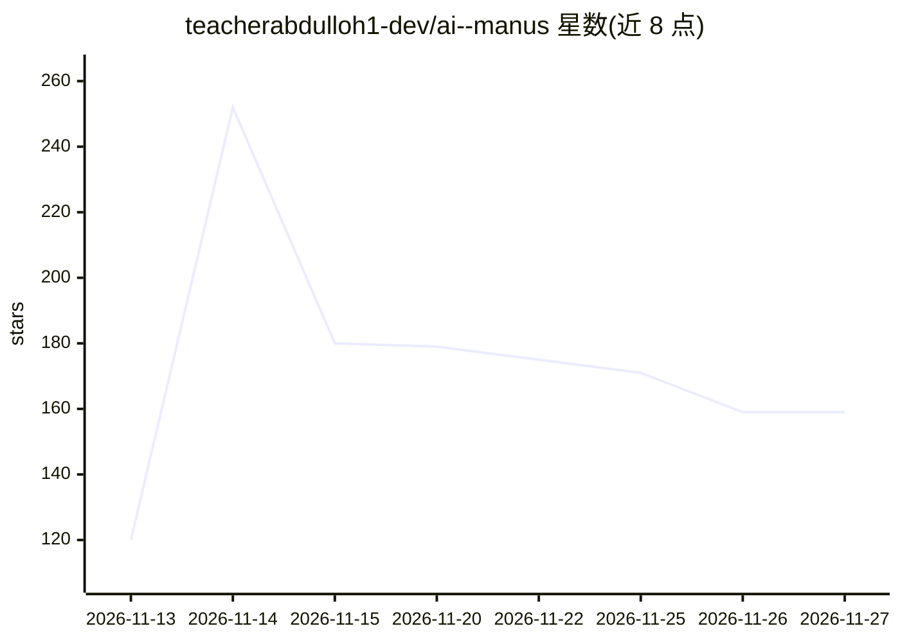

# teacherabdulloh1-dev/ai--manus

⭐ 159 · Apache-2.0 · 推送 2026-11-15 · [GitHub](https://github.com/teacherabdulloh1-dev/ai--manus) · 个人维护

**面向个人用户的自主 AI Agent：代为执行代码与浏览器操作**

README 描述的通用自主 AI Agent 系统，支持自主编写并执行代码、控制浏览器（打开页面、填表、采集信息）、执行多步骤日常任务，声称可在沙箱环境运行工具。定位为面向家庭、学习与轻量工作的个人助手，覆盖代码执行与浏览器控制两类动作，并声明可在会话间复用任务模式。README 给出兼容性硬件表格与上手步骤，但未提供具体安装命令、技术栈细节或 API 接入方式。

## 筛选速览

| 维度 | 判定 | 备注 |
|---|---|---|
| AI 角色 | `ai-native` | 本体是模型或模型工具 |
| 许可风险 | `permissive` | Apache-2.0 |
| 部署形态 | `None` |  |
| 模型依赖 | — | README 未给出锁定关系 |
| 硬件要求 | — | 无带数字的原话,不猜 |
| 安装摩擦 | `low` | 无编译、无系统依赖或容器化 |
| 成熟度 | — | 结构信号不足 |

## 能力要点

- 自主编写并执行代码完成任务的 Agent 能力
- 浏览器控制：导航页面、填表、采集信息
- 代码与浏览器动作可在同一多步任务流中衔接
- 定位家庭、学习与轻量办公的小规模场景

## 适用场景

- 让 Agent 代为运行脚本和整理研究资料
- 自动浏览网页、填写重复表单并汇总信息
- 把日常重复性小任务交给后台助手处理

## 场景标签

`AI 助手` `浏览器自动化` `编码 Agent` · 领域:效率与自动化

## 证据(README 行号)

> L18: Manus is an autonomous AI agent designed to run code and control a browser on your behalf. Instead of acting like a
> L22: Manus is not a heavy studio suite or a complex enterprise platform. It is a focused helper built for home, study, a

## 星数曲线

2026-11-13 120 → 2026-11-27 159（+39）

---
*卡片 v1 · prompt 1.4 · 生成 2026-11-17 · 置信度 mid · 依据 README sha `d6b739dfe7df` · [字段定义](../../DATASET.md)*
