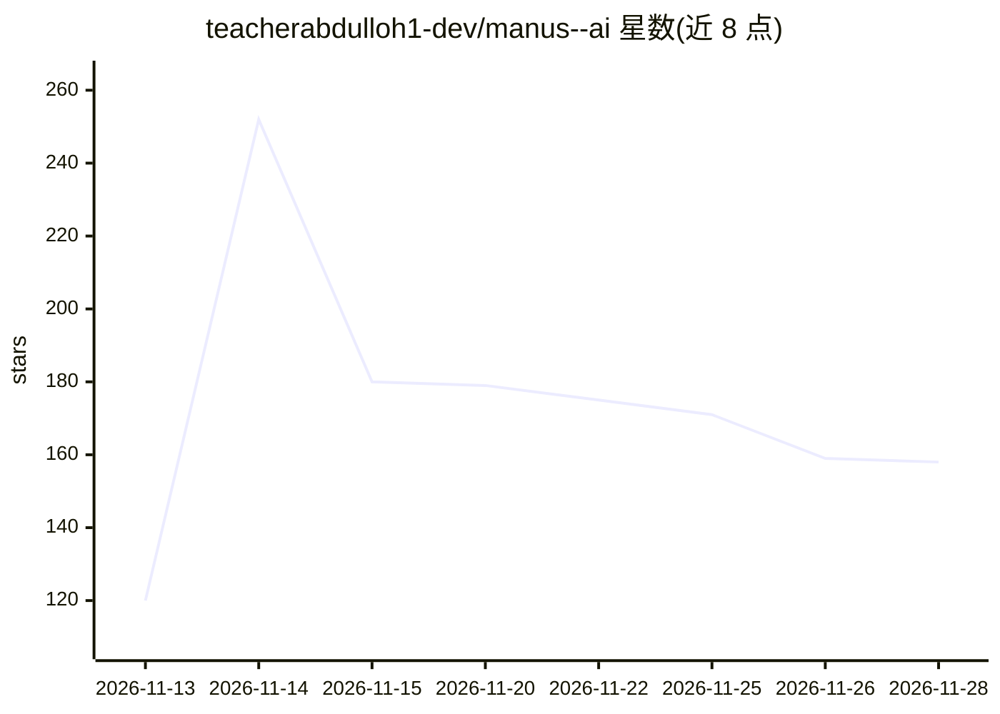

# teacherabdulloh1-dev/manus--ai

⭐ 158 · Apache-2.0 · 推送 2026-11-15 · [GitHub](https://github.com/teacherabdulloh1-dev/manus--ai) · 个人维护

**面向个人用户的自主 AI Agent：自动执行代码与浏览器操作**

README 描述 Manus 为自主 AI 代理，可代用户编写并执行脚本、控制浏览器（导航网页、填写表单、采集信息）、执行多步骤任务，定位为家庭、学习与轻量办公场景的个人助手，强调小规模使用而非企业平台。提供操作系统/CPU/内存/存储的兼容性表格与上手步骤说明，但 README 未给出任何安装命令、源码结构或 API 接入方式，实际获取途径仅有“Download Manus”字样与一个代码（PROMO2026），可验证的技术细节有限。

## 筛选速览

| 维度 | 判定 | 备注 |
|---|---|---|
| AI 角色 | `ai-native` | 本体是模型或模型工具 |
| 许可风险 | `permissive` | Apache-2.0 |
| 部署形态 | `None` |  |
| 模型依赖 | — | README 未给出锁定关系 |
| 硬件要求 | — | 无带数字的原话,不猜 |
| 安装摩擦 | `low` | 无编译、无系统依赖或容器化 |
| 成熟度 | — | 结构信号不足 |

## 能力要点

- 自主代码执行：代理自行编写并运行脚本完成任务
- 浏览器控制：导航网页、填写表单、采集信息
- 代码与浏览器动作可在同一工作流中衔接
- 跨会话保持任务模式，支持后台常驻的个人助手形态

## 适用场景

- 让代理代为完成查网页、填表单等重复性操作
- 学习与研究场景中整理资料、运行小脚本
- 轻量办公中汇总多页面信息生成小结

## 场景标签

`AI 助手` `浏览器自动化` `编码 Agent` · 领域:效率与自动化

## 证据(README 行号)

> L10: - **Autonomous Code Execution:** Manus AI agent runs code on its own to complete tasks, so you can focus on decisio
> L18: Manus is an autonomous AI agent designed to run code and control a browser on your behalf. Instead of acting like a

## 星数曲线

2026-11-13 120 → 2026-11-28 158（+38）

---
*卡片 v1 · prompt 1.4 · 生成 2026-11-17 · 置信度 mid · 依据 README sha `291d65f725fe` · [字段定义](../../DATASET.md)*
