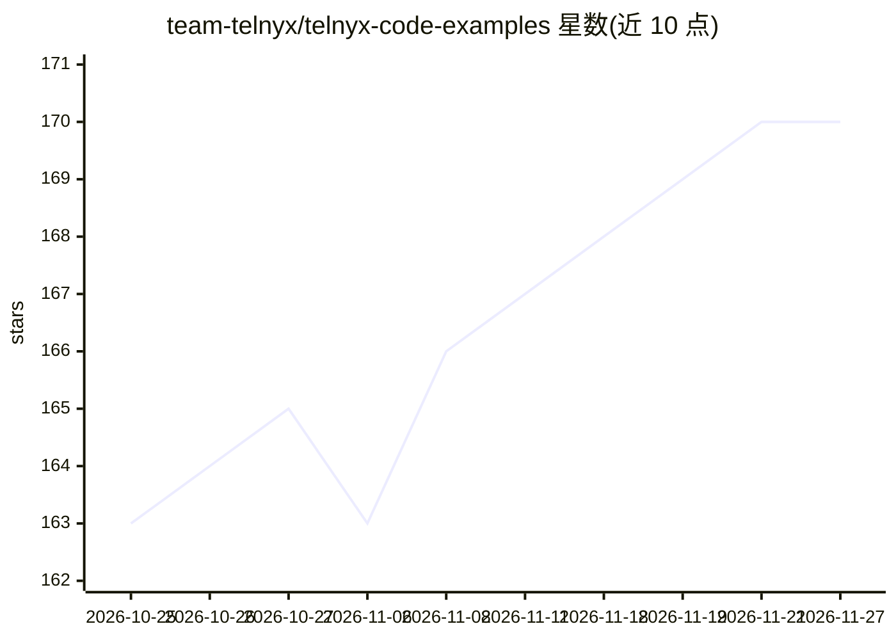

# team-telnyx/telnyx-code-examples

⭐ 170 · TypeScript · MIT · 推送 2026-11-26 · [GitHub](https://github.com/team-telnyx/telnyx-code-examples) · [官网](https://developers.telnyx.com) · 组织维护

**面向 Telnyx 平台开发者的可运行示例代码集**

Telnyx 平台的示例代码集合，每个示例为自包含项目，含可运行代码、文档与环境配置，克隆并配置后即可运行；每个示例目录带 Quick Start 安装/运行命令、API.md 端点参考与 GUIDE.md 指南。覆盖 Voice AI（约 160+ 例）、IVR、会议通话、外呼、号码查询、AI Inference 绑定、Edge Compute 等，语言含 Python/Node.js/Go/PHP/Ruby/C#/Java/TypeScript。

## 筛选速览

| 维度 | 判定 | 备注 |
|---|---|---|
| AI 角色 | `ai-knowledge` | 知识聚合/清单类 |
| 许可风险 | `permissive` | MIT |
| 部署形态 | `None` |  |
| 模型依赖 | — | README 未给出锁定关系 |
| 硬件要求 | — | 无带数字的原话,不猜 |
| 安装摩擦 | `low` | 无编译、无系统依赖或容器化 |
| 成熟度 | — | 结构信号不足 |

## 能力要点

- 162+ 个 Voice AI 自包含示例，覆盖 IVR、会议、外呼、转写、情感监测等
- 每个示例附 Quick Start、API.md 端点参考与 GUIDE.md 指南
- 支持 Python/Node.js/Go/PHP/Ruby/C#/Java 等多语言版本
- 含 Telnyx Agent SDK、AI Inference 绑定与 Edge Compute 用法示例

## 适用场景

- 参考官方示例快速接入 Telnyx 语音与短信 API
- 为呼叫中心搭建 IVR、录音、坐席辅助等流程
- 构建 AI 语音助手、实时转写或外呼工作流

## 场景标签

`语音 Agent` `教程课程` · 领域:对话与助手

## 证据(README 行号)

> L3: Production-ready code examples for the Telnyx platform. Each example is a self-contained project with working code, 
> L18:  Voice AI (162 examples)

## 星数曲线

2026-10-25 163 → 2026-11-27 170（+7）

---
*卡片 v1 · prompt 1.4 · 生成 2026-11-26 · 置信度 high · 依据 README sha `a14b74b29b73` · [字段定义](../../DATASET.md)*
