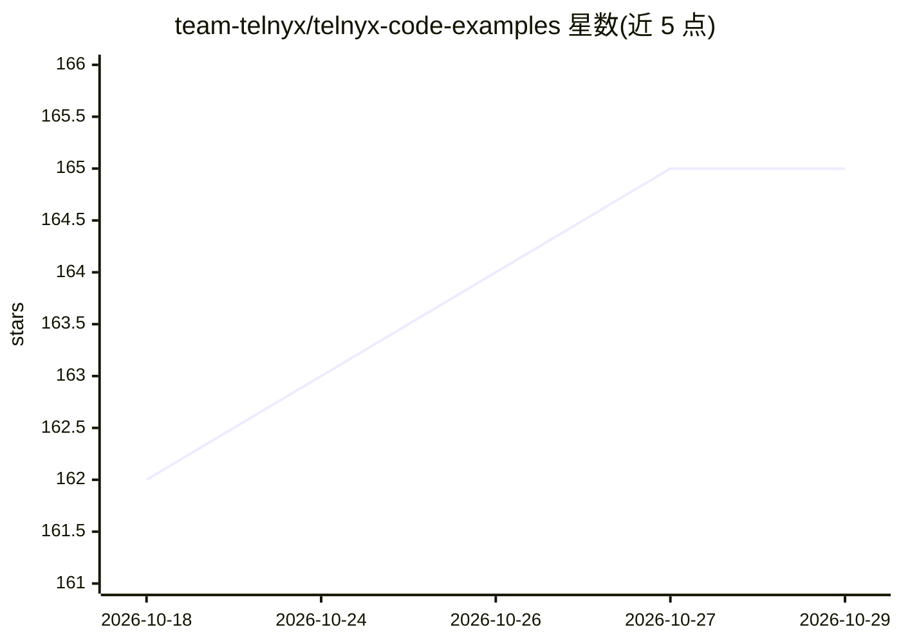

# team-telnyx/telnyx-code-examples

⭐ 165 · Python · MIT · 推送 2026-10-28 · [GitHub](https://github.com/team-telnyx/telnyx-code-examples) · [官网](https://developers.telnyx.com) · 组织维护

**Telnyx 通信平台的代码示例集：Voice AI、呼叫、SMS 等**

Telnyx 官方维护的生产级代码示例仓库，每个示例为独立项目，含可运行代码、文档与环境配置，覆盖 Voice AI（161 个示例）、IVR、呼叫控制与转移、会议、语音信箱处理、深度伪造语音检测、传真结构化提取、多语言配音等场景，另含 SIP、SMS、IoT 等主题。示例以 Node.js/Python/Go/Java/PHP/Ruby/C# 等多语言编写，克隆配置后可运行；多个示例使用 Telngx Edge Compute 与 AI Inference binding 做 LLM 推理、STT/TTS 与通话处理。

## 筛选速览

| 维度 | 判定 | 备注 |
|---|---|---|
| AI 角色 | `ai-knowledge` | 知识聚合/清单类 |
| 许可风险 | `permissive` | MIT |
| 部署形态 | `None` |  |
| 模型依赖 | — | README 未给出锁定关系 |
| 硬件要求 | — | 无带数字的原话,不猜 |
| 安装摩擦 | `low` | 无编译、无系统依赖或容器化 |
| 成熟度 | — | 结构信号不足 |

## 能力要点

- Voice AI 类 161 个示例，覆盖 IVR、会议、AI 呼叫路由、实时转录
- 多语言实现（Node.js/Python/Go/Java/PHP/Ruby/C# 等）
- 每个示例含 Quick Start、API.md 与 GUIDE.md
- 多个示例基于 Edge Compute 与 AI Inference binding 运行 STT→LLM→TTS 循环

## 适用场景

- 开发者快速上手 Telnyx Voice AI 与呼叫控制 API
- 参考实现搭建 IVR、呼叫中心或语音 AI 助手
- 学习在边缘计算环境接入 LLM 推理与消息 API

## 场景标签

`语音 Agent` `语音合成` · 领域:对话与助手

## 证据(README 行号)

> L1: # Telnyx Code Examples - AI Communications Infrastructure
> L3: Production-ready code examples for the Telnyx platform. Each example is a self-contained project with working code, 
> L18:  Voice AI (161 examples)

## 星数曲线

2026-10-18 162 → 2026-10-29 165（+3）

---
*卡片 v1 · prompt 1.4 · 生成 2026-10-22 · 置信度 mid · 依据 README sha `0b2a0b512cc3` · [字段定义](../../DATASET.md)*
