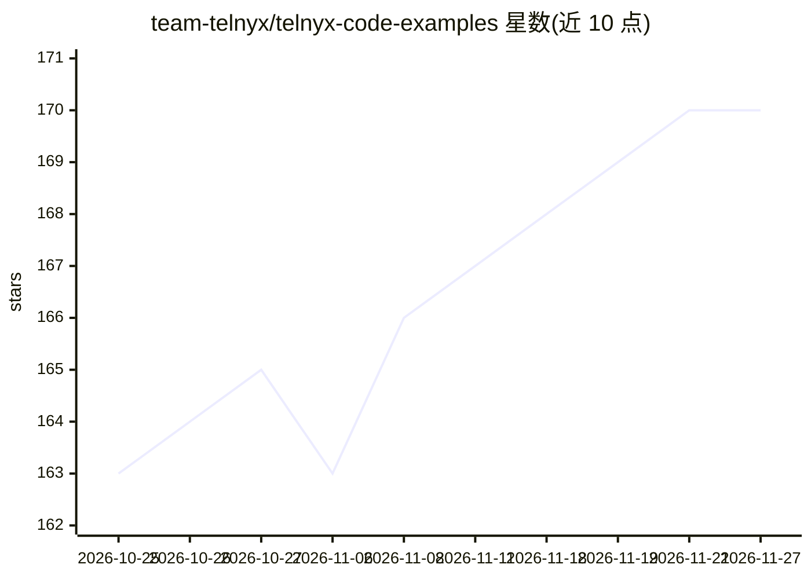

# team-telnyx/telnyx-code-examples

⭐ 170 · TypeScript · MIT · 推送 2026-11-26 · [GitHub](https://github.com/team-telnyx/telnyx-code-examples) · [官网](https://developers.telnyx.com) · 组织维护

**面向开发者的 Telnyx 语音 AI/SMS/SIP/IoT 代码示例集**

Telnyx 官方维护的平台代码示例集合，每个示例为自包含项目，含可运行代码、文档与环境配置，clone 后配置即可运行。覆盖 Voice AI（160+ 例，IVR、AI 呼叫路由、转写、深伪语音检测、边缘部署）、SMS/RCS、SIP 中继与 IoT API 等。示例按多语言提供（Python/Node.js/Go/PHP/Ruby/Java/C#/TypeScript），各示例附 Quick Start、API.md 端点参考与 GUIDE.md 指南。

## 筛选速览

| 维度 | 判定 | 备注 |
|---|---|---|
| AI 角色 | `ai-knowledge` | 知识聚合/清单类 |
| 许可风险 | `permissive` | MIT |
| 部署形态 | `None` |  |
| 模型依赖 | — | README 未给出锁定关系 |
| 硬件要求 | — | 无带数字的原话,不猜 |
| 安装摩擦 | `low` | 无编译、无系统依赖或容器化 |
| 成熟度 | — | 结构信号不足 |

## 能力要点

- Voice AI 类目含 162+ 个自包含示例项目
- 示例覆盖 8 种语言：Python/Node.js/Go/PHP/Ruby/Java/C#/TypeScript
- 每个示例含 Quick Start、API.md 端点参考与 GUIDE.md 指南
- 场景覆盖 IVR、AI 呼叫路由、实时转写、语音深伪检测、外呼等

## 适用场景

- 为 Telnyx 平台接入语音通话、IVR、外呼功能查找参考实现
- 搭建 AI 语音客服、来电路由或呼叫转写类应用
- 学习如何用 Agent SDK 与 Edge Compute 构建语音 agent

## 场景标签

`语音 Agent` · 领域:对话与助手

## 证据(README 行号)

> L3: Production-ready code examples for the Telnyx platform. Each example is a self-contained project with working code, 
> L16: Each example's README has a Quick Start with the exact install/run commands for its language, an `API.md` typed end
> L18:  Voice AI (162 examples)

## 星数曲线

2026-10-25 163 → 2026-11-27 170（+7）

---
*卡片 v1 · prompt 1.4 · 生成 2026-11-27 · 置信度 high · 依据 README sha `bc3b0ddc4e17` · [字段定义](../../DATASET.md)*
