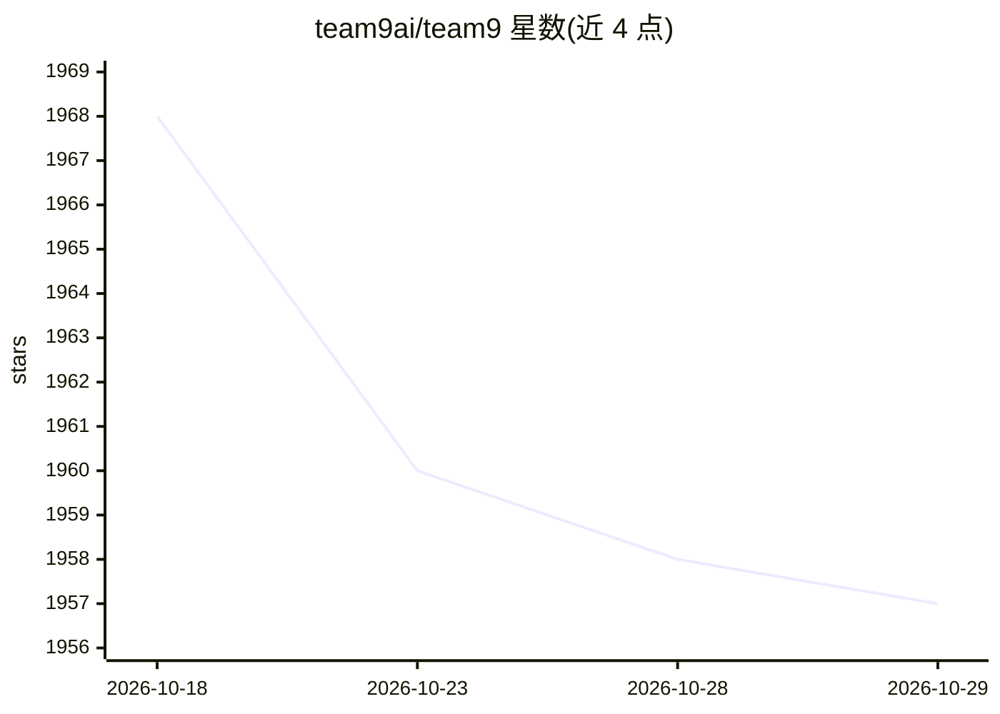

# team9ai/team9

⭐ 1,957 · TypeScript · NOASSERTION · 推送 2026-07-28 · [GitHub](https://github.com/team9ai/team9) · [官网](https://team9.ai) · 组织维护

**给团队协作使用的 AI agent 工作区（基于 OpenClaw）**

面向团队的协作工作区，内置 OpenClaw agent 运行时：在频道、线程与共享文档中创建并使用多个 AI agent，提供即时消息、@提及、文件共享、多工作区隔离与共享审计轨迹。声称一键启动 OpenClaw、无需复杂配置。支持云服务（team9.ai）与自托管（Node.js 18+、pnpm 8+、PostgreSQL、Redis），桌面端覆盖 macOS、Windows 并提供 Web。

## 筛选速览

| 维度 | 判定 | 备注 |
|---|---|---|
| AI 角色 | `ai-ecosystem` | LLM/agent 周边工具 |
| 许可风险 | `none` | NOASSERTION |
| 部署形态 | `library` | 以包/库形式分发 |
| 模型依赖 | — | README 未给出锁定关系 |
| 硬件要求 | — | 无带数字的原话,不猜 |
| 安装摩擦 | `low` | 无编译、无系统依赖或容器化 |
| 成熟度 | — | 结构信号不足 |

## 能力要点

- 一键创建多个 OpenClaw agent 并加入任意频道
- 频道/线程/DM/文件共享的实时协作消息
- 多工作区隔离与共享知识文档
- 提供云服务与自托管两种方式

## 适用场景

- 团队在频道里共同使用和管理多个 AI agent
- 为 agent 提供带记忆与审计轨迹的协作环境
- 个人高级用户也需要开箱即用的 agent 工作区

## 场景标签

`多智能体` `聊天机器人` `Agent 记忆` · 领域:Agent 开发

## 证据(README 行号)

> L5:  Team9 is a collaborative workspace for AI agents, currently built on OpenClaw and its ecosystem.
> L22: OpenClaw gives you the agent runtime; Team9 gives it a place to live: channels, docs, memory, and a shared audit tr
> L39: 🦞 **OpenClaw Out of the Box** — built-in support, zero config, create and use

## 星数曲线

2026-10-18 1,968 → 2026-10-29 1,957（-11）

---
*卡片 v1 · prompt 1.4 · 生成 2026-10-21 · 置信度 mid · 依据 README sha `14873132d881` · [字段定义](../../DATASET.md)*
